# BÁO CÁO ĐỒ ÁN THỰC HÀNH BIG DATA
## Đề tài: Triển khai cụm Spark và Quản lý dữ liệu trên HDFS bằng Docker Compose

---

## Phần 1: Giới thiệu đề tài và Sơ đồ kiến trúc cụm

### 1.1. Mục tiêu đề tài
- Thiết kế và triển khai cụm tính toán phân tán **Apache Hadoop (HDFS + YARN)** và **Apache Spark (Standalone + Spark on YARN)** hoàn chỉnh trên môi trường **Docker Compose** (chạy qua WSL2 `Ubuntu-26.04` trên Windows 11).
- Thực hành quản trị dữ liệu phân tán trên **HDFS**: chia block 128 MB, quản lý hệ số nhân bản (`replication factor`), kiểm chứng tính bền vững dữ liệu qua Docker Volume và khả năng chịu lỗi khi DataNode ngừng hoạt động.
- Phát triển và vận hành các ứng dụng **PySpark** thực tế trên bộ dữ liệu **MovieLens** (`movies.csv`, `ratings_1m.csv` 25 MB và `ratings.csv` 647 MB) ở cả hai kiến trúc **Spark Standalone** và **Spark on YARN** (`client` mode và `cluster` mode).

### 1.2. Sơ đồ kiến trúc cụm (11 dịch vụ chia theo Docker Compose Profile)

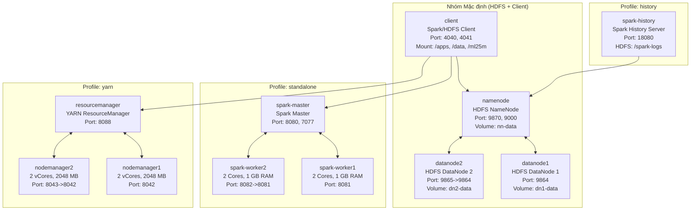

### 1.3. Thông số môi trường và cổng dịch vụ
| Thành phần | Container / Hostname | Cổng Web / RPC (Windows) | Cấu hình chính |
| :--- | :--- | :--- | :--- |
| **HDFS NameNode** | `namenode` | `9870` (HTTP), `9000` (RPC) | `dfs.replication=2`, `dfs.blocksize=128MB` |
| **HDFS DataNode 1, 2** | `datanode1`, `datanode2` | `9864`, `9865` | Docker volumes `dn1-data`, `dn2-data` |
| **Spark Master** | `spark-master` | `8080` (HTTP), `7077` (RPC) | Profile `standalone` |
| **Spark Worker 1, 2** | `spark-worker1`, `spark-worker2` | `8081`, `8082` | Mỗi worker `2 cores`, `1024 MB RAM` |
| **YARN ResourceManager** | `resourcemanager` | `8088` | Profile `yarn`, Capacity Scheduler |
| **YARN NodeManager 1, 2** | `nodemanager1`, `nodemanager2` | `8042`, `8043` | Mỗi node `2 vCores`, `2048 MB RAM` (tổng `4096 MB`) |
| **Spark History Server** | `spark-history` | `18080` | Đọc event log tại `hdfs://namenode:9000/spark-logs` |
| **Client Node** | `client` | `4040`, `4041` | Mount `./apps:/apps`, `./data:/data`, `/ml25m` |

---

## Phần 2: Giai đoạn 1 (Buổi 1) — Triển khai cụm bằng Docker Compose

### 2.1. Lý thuyết ngắn
- **Docker Compose Profiles** cho phép nhóm các container theo chức năng (`standalone`, `yarn`, `history`) trên cùng một image cơ sở `spark-hdfs-lab:1.0` (Ubuntu 22.04, OpenJDK 11, Hadoop 3.3.6, Spark 3.5.1). Việc tách profile giúp máy trạm giới hạn RAM 10 GB cho WSL2 vận hành mượt mà mà không bị tràn bộ nhớ.
- **Docker Named Volumes** (`nn-data`, `dn1-data`, `dn2-data`) tách biệt vòng đời dữ liệu HDFS (metadata của NameNode tại `/hadoop/dfs/name` và block vật lý của DataNode tại `/hadoop/dfs/data`) khỏi vòng đời của container.

### 2.2. Khởi chạy cụm và kiểm tra Web UI (Ảnh A1 – A4)
- **Lệnh khởi chạy cụm 10 container:**
  ```bash
  docker compose --profile standalone --profile yarn up -d
  docker compose ps
  ```
- **Minh chứng kết quả:**
  - **Ảnh A1 (`A1_docker_ps.png`):** Cả 10 container (`namenode`, `datanode1`, `datanode2`, `client`, `spark-master`, `spark-worker1`, `spark-worker2`, `resourcemanager`, `nodemanager1`, `nodemanager2`) đều ở trạng thái `Up`.
    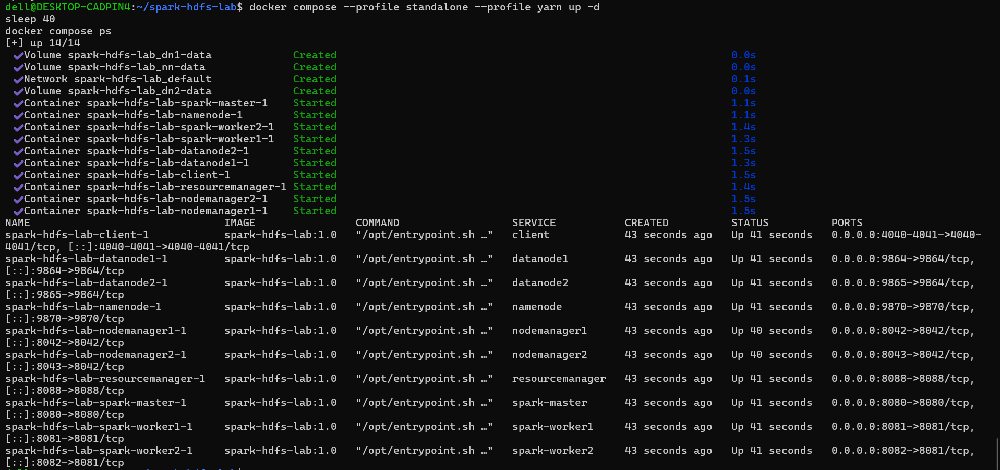
  - **Ảnh A2 (`A2_namenode.png` & `A2_datanodes.png`):** Giao diện NameNode UI (`http://localhost:9870`) hiển thị trạng thái `active`, `Live Nodes: 2`, và danh sách 2 DataNode (`datanode1`, `datanode2`) đang hoạt động.
    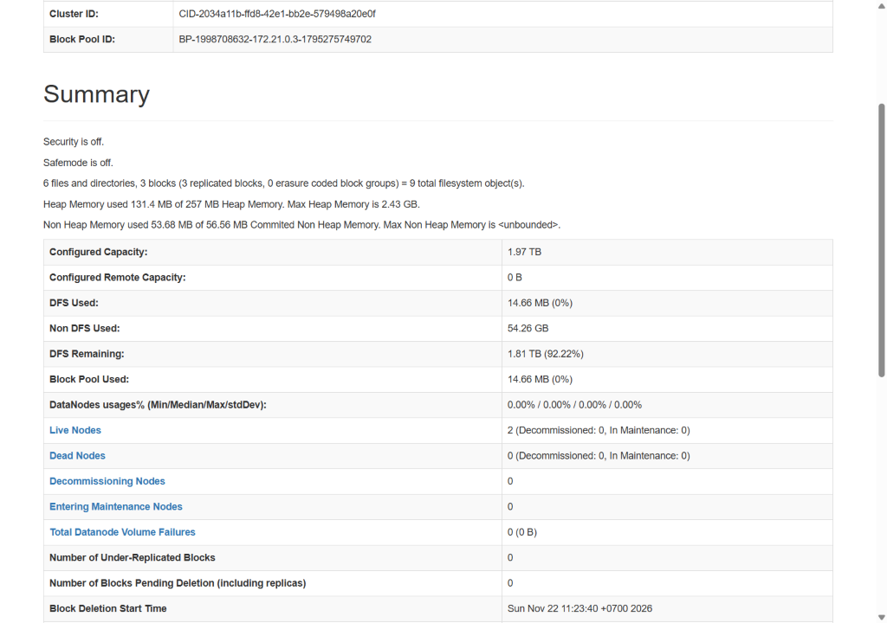
    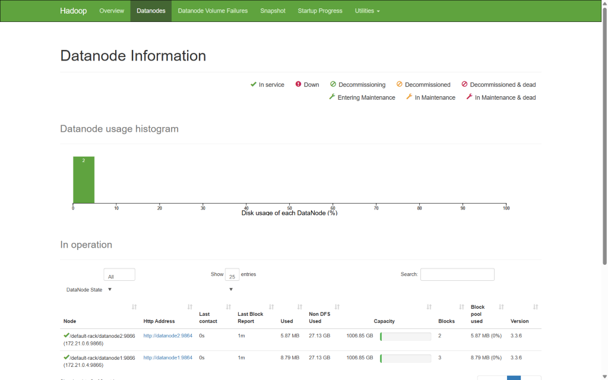
  - **Ảnh A3 (`A3_yarn_rm.png` & `A3_yarn_nodes.png`):** Giao diện YARN ResourceManager (`http://localhost:8088/cluster` và `/cluster/nodes`) hiển thị `Active Nodes: 2`, tổng tài nguyên `<memory:4 GB, vCores:4>`, cả 2 NodeManager đều ở trạng thái `RUNNING`.
    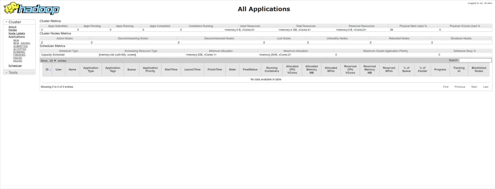
    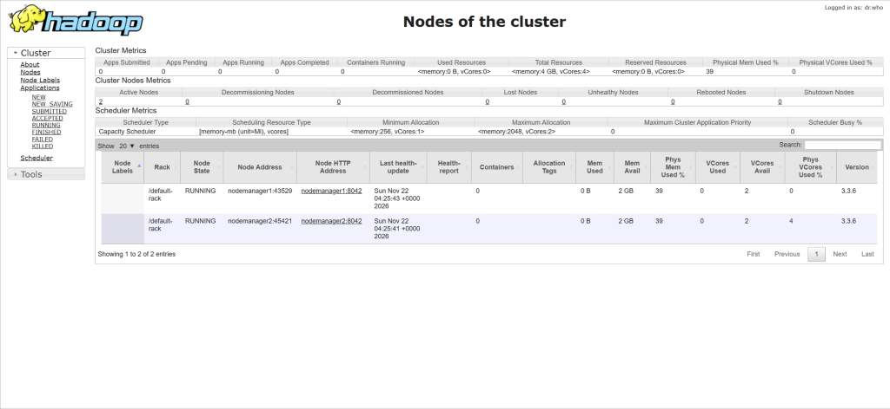
  - **Ảnh A4 (`A4_spark_master.png`):** Giao diện Spark Master (`http://localhost:8080`) hiển thị `Alive Workers: 2`, `Cores in use: 4 Total`, `Memory in use: 2.0 GiB Total`.
    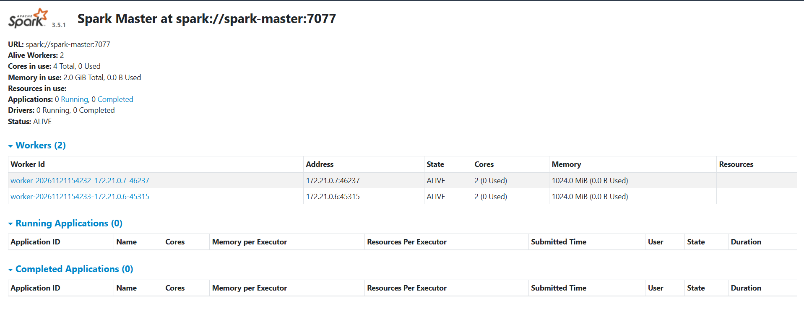

### 2.3. Bài tập BT1.2: Kiểm chứng tính bền vững dữ liệu qua Docker Volume
- **Thực hiện:** Tạo thư mục `/user/student`, tải `movies.csv` (2.9 MB) lên HDFS, tắt toàn bộ cụm bằng `docker compose down`, sau đó bật lại bằng `docker compose up -d` và kiểm tra lại file.
- **Kết quả & Giải thích:** File `/user/student/movies.csv` vẫn còn nguyên vẹn và đọc được nội dung (`Toy Story (1995)`, `Jumanji (1995)`...). Lý do: lệnh `docker compose down` (không kèm cờ `-v`) chỉ xóa container và network, trong khi metadata của NameNode được lưu trong volume `nn-data` và các block dữ liệu được lưu trong `dn1-data`, `dn2-data`. Khi container khởi tạo lại, script `entrypoint.sh` kiểm tra thư mục `/hadoop/dfs/name/current` đã tồn tại nên không format lại NameNode.
  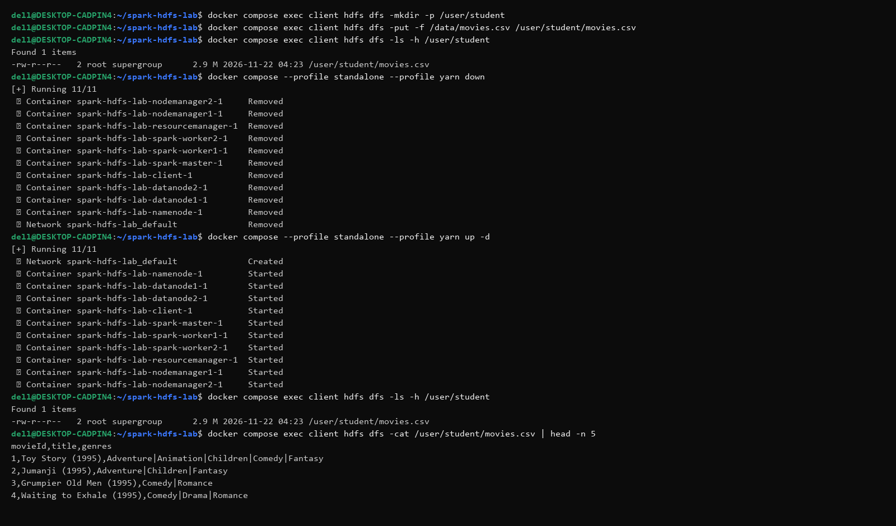

### 2.4. Bài tập BT1.3: So sánh hệ số nhân bản Replication 2 và Replication 1
- **Thực hiện:**
  ```bash
  docker compose exec client hdfs dfs -put -f /data/movies.csv /user/student/movies_rep2.csv
  docker compose exec client hdfs dfs -D dfs.replication=1 -put -f /data/movies.csv /user/student/movies_rep1.csv
  docker compose exec client hdfs fsck /user/student/movies_rep2.csv -files -blocks -locations
  docker compose exec client hdfs fsck /user/student/movies_rep1.csv -files -blocks -locations
  ```
- **Kết quả:**
  - `movies_rep2.csv`: `Live_repl=2`, block được lưu đồng thời trên cả 2 DataNode (`172.21.0.6:9866` và `172.21.0.4:9866`), `Average block replication: 2.0`.
  - `movies_rep1.csv`: `Live_repl=1`, block chỉ nằm trên 1 DataNode duy nhất (`172.21.0.4:9866`), `Average block replication: 1.0`.
  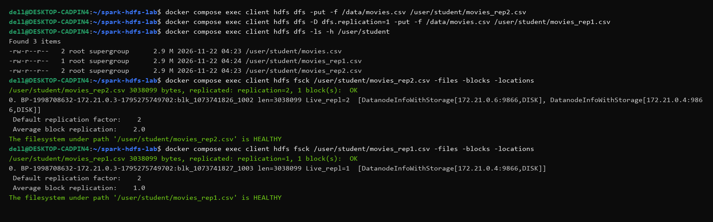

---

## Phần 3: Giai đoạn 2 (Buổi 2) — Quản lý dữ liệu trên HDFS

### 3.1. Lý thuyết ngắn
- HDFS lưu trữ các tập tin lớn bằng cách cắt nhỏ thành các **block** có kích thước cố định (mặc định **128 MB** = `134,217,728 bytes`).
- Mỗi block được nhân bản sang nhiều DataNode theo hệ số `dfs.replication` (trong cụm lab là `2`). NameNode quản lý không gian tên (namespace) và ánh xạ `File -> Blocks -> DataNodes`, còn DataNode lưu trữ và phục vụ đọc/ghi block trực tiếp.

### 3.2. Bài tập BT2.1: Thao tác cây thư mục trên HDFS (Ảnh B1)
- **Thực hiện:** Tạo cây thư mục `/bigdata/{input,backup,temp}`, tải `movies.csv` và `ratings_1m.csv` vào `/bigdata/input`, sao chép (`cp`), đổi tên (`mv` thành `movies_2026.csv`), và xóa thư mục tạm (`rm -r /bigdata/temp`).
  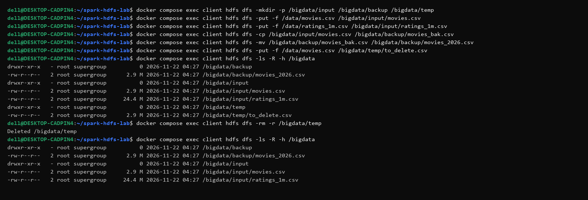

### 3.3. Bài tập BT2.2 & BT2.6: Chia block file lớn 647 MB và duyệt trên Web UI (Ảnh B2, B3)
- **Thực hiện:** Tải `/ml25m/ratings.csv` (`678,260,987 bytes` ≈ `646.84 MB`) lên `/bigdata/input/ratings_25m.csv` và kiểm tra bằng `hdfs fsck -files -blocks -locations` cũng như giao diện **NameNode UI → Utilities → Browse the file system**.
- **Kết quả:** File `678,260,987 bytes` được chia thành đúng **6 block**:
  - **Block 0 → Block 4:** 5 block đầu mỗi block đúng `134,217,728 bytes` (**128 MB**).
  - **Block 5:** Block cuối cùng chứa phần dư `7,172,347 bytes` (**~6.84 MB**).
  - Tất cả 6 block đều có `Live_repl=2` trên cả `datanode1` và `datanode2`.
  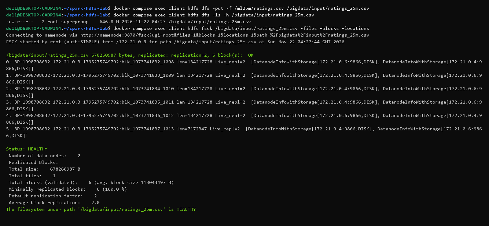
  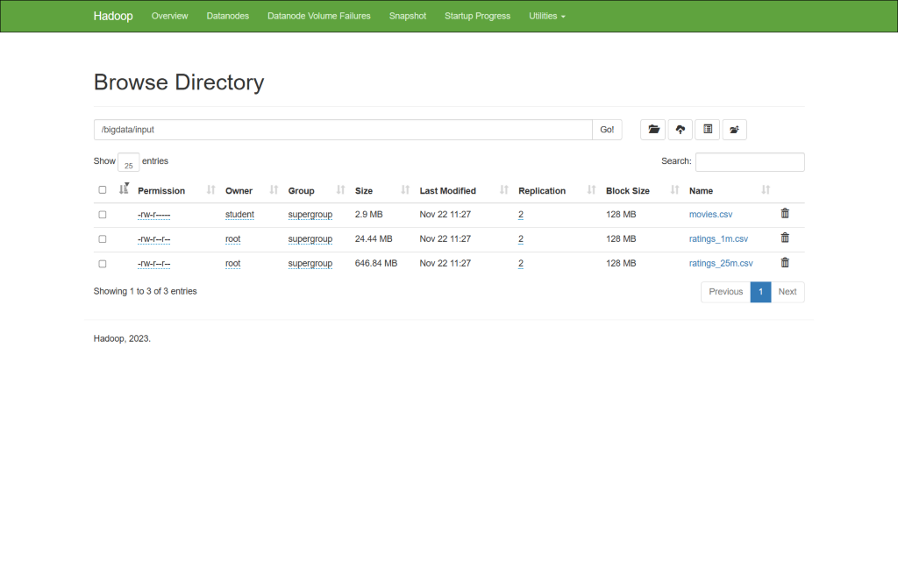
  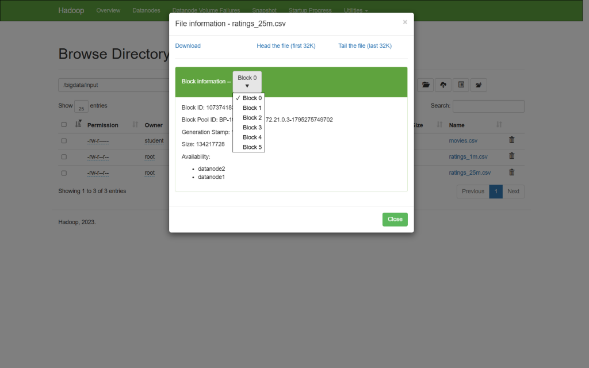

### 3.4. Bài tập BT2.3: Thay đổi hệ số nhân bản động với `setrep` (Ảnh B4)
- **Thực hiện:**
  - Giảm hệ số nhân bản xuống 1: `hdfs dfs -setrep -w 1 /bigdata/input/ratings_25m.csv` → `fsck` ghi nhận cả 6 block giảm xuống `Live_repl=1` (`Average block replication: 1.0`).
  - Tăng hệ số nhân bản lại lên 2: `hdfs dfs -setrep -w 2 /bigdata/input/ratings_25m.csv` → NameNode chỉ thị DataNode sao chép các block thiếu, `fsck` trở lại `Live_repl=2` (`Average block replication: 2.0`).
  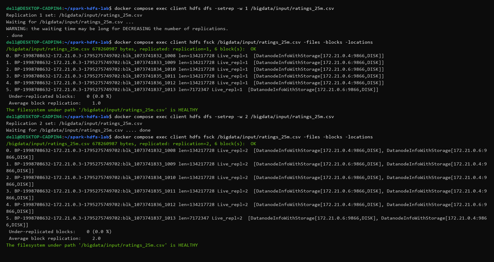

### 3.5. Bài tập BT2.4: Kiểm chứng khả năng chịu lỗi khi DataNode ngừng hoạt động (Ảnh B5, B6)
- **Thực hiện:**
  1. Dừng `datanode2`: `docker compose stop datanode2`.
  2. Nhờ cấu hình `dfs.namenode.heartbeat.recheck-interval = 30000` (30 giây), sau khoảng **90 giây** (`2 * 30s + 10 * 3s`), NameNode chuyển `datanode2` sang trạng thái **Dead datanodes (1)**.
  3. Kiểm tra `hdfs dfsadmin -report` và `hdfs fsck /bigdata/input/ratings_25m.csv`: cả 6 block của `ratings_25m.csv` vẫn đọc được bình thường từ `datanode1` (`Live_repl=1`), nhưng ở trạng thái **`Under replicated`** (`Target Replicas is 2 but found 1 live replica(s)`).
  4. **Nhận xét quan trọng:** Vì cụm chỉ có tổng cộng **2 DataNode** mà `replication=2`, khi `datanode2` chết thì chỉ còn duy nhất `datanode1` sống, nên HDFS **không có DataNode thứ 3** để tự nhân bản bù. Các block giữ trạng thái `under-replicated` cho đến khi `datanode2` được bật lại (`docker compose start datanode2`), lúc đó `Live datanodes (2)` và `Under-replicated blocks: 0` lập tức được khôi phục.
  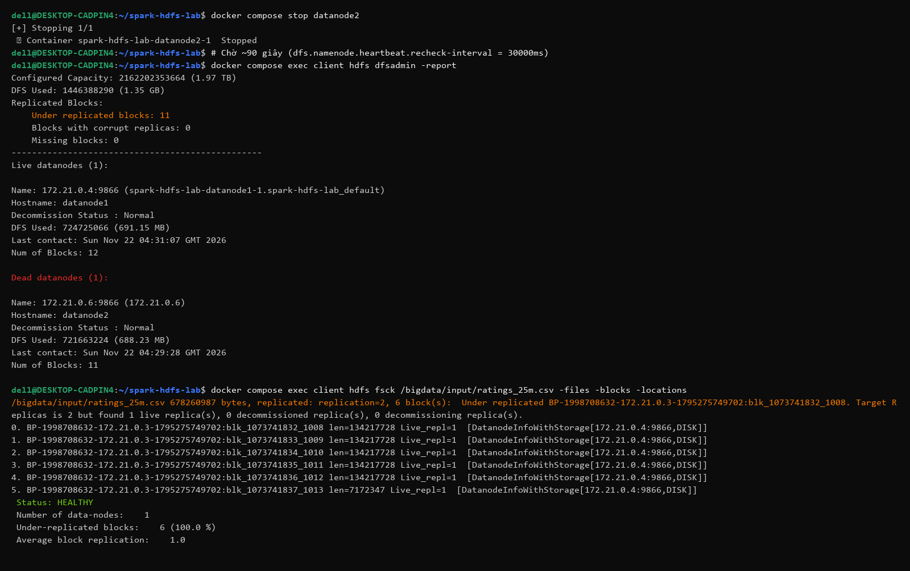
  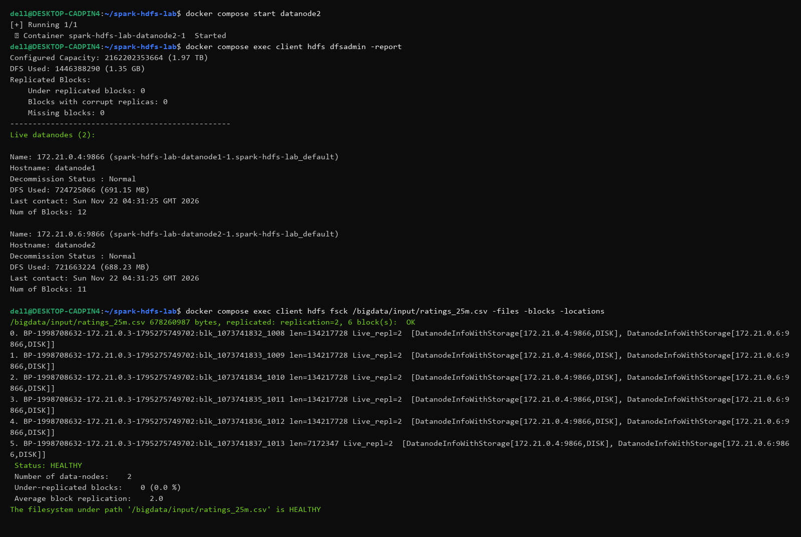

### 3.6. Bài tập BT2.5: Quản lý quyền truy cập và dung lượng HDFS
- **Thực hiện:** Đổi quyền `chmod 640`, `chown student:supergroup` cho `/bigdata/input/movies.csv`, kiểm tra dung lượng bằng `hdfs dfs -du -h /bigdata/input` và `hdfs dfs -df -h /`.
- **Kết quả:** `du -h` hiển thị rõ 2 cột: kích thước gốc của file (`646.8 M`) và dung lượng vật lý thực tế chiếm trên đĩa HDFS sau khi nhân bản `replication=2` (`1.3 G`).
  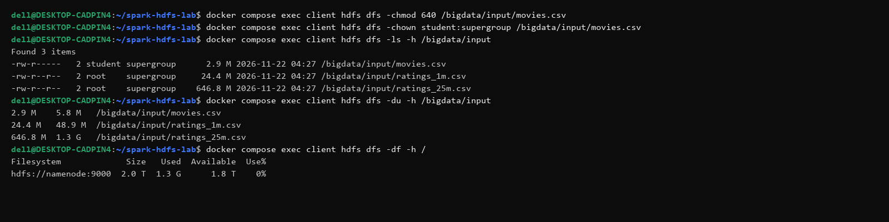

---

## Phần 4: Giai đoạn 3 (Buổi 3) — Spark Standalone

### 4.1. Lý thuyết ngắn & Chuẩn bị
- Ở chế độ **Spark Standalone**, cụm được quản lý bởi bộ điều phối riêng của Spark gồm `spark-master` (cổng `7077`/`8080`) và các `spark-worker` (`spark-worker1`, `spark-worker2`).
- Để tiết kiệm RAM, nhóm YARN được dừng tạm thời, bật thêm `spark-history` (`:18080`) và bắt buộc tạo sẵn thư mục `/spark-logs` trên HDFS (`hdfs dfs -mkdir -p /spark-logs`) để Spark ghi event log.

### 4.2. Ví dụ 1 & BT3.1: Ước lượng số $\pi$ (`pi.py`) với 10, 100, 1000 Partition (Ảnh C2)
- Vì bản Spark cài từ `pip` (`spark-pip/`) không đi kèm file jar `spark-examples`, ứng dụng `pi.py` được viết bằng PySpark sử dụng phương pháp Monte Carlo ($100,000 \times \text{partitions}$ điểm ngẫu nhiên).
- **Bảng so sánh thời gian chạy theo số lượng partition:**

| Số Partition (`slices`) | Tổng số mẫu (`n`) | Giá trị $\pi$ ước lượng | Thời gian thực thi | Nhận xét |
| :---: | :---: | :---: | :---: | :--- |
| **10** | $1,000,000$ | `3.137120` | **4.60 giây** | Chi phí lập lịch thấp, hội tụ nhanh |
| **100** | $10,000,000$ | `3.140440` | **13.77 giây** | Độ chính xác cao hơn, tận dụng tốt 4 cores của 2 worker |
| **1000** | $100,000,000$ | `3.135240` | **71.83 giây** | Số lượng task lớn (1000 tasks) làm tăng overhead điều phối task |

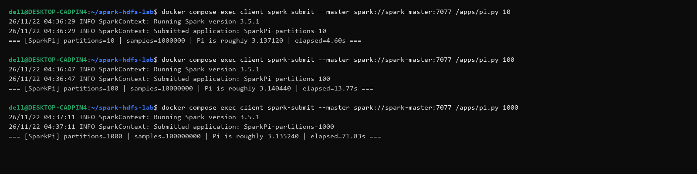

### 4.3. Ví dụ 2 & BT3.2: WordCount trên `movies.csv` và quan sát DAG tại cổng 4040 (Ảnh C3, C4)
- **Kết quả đếm từ trên `movies.csv`:** Các từ khóa thể loại và từ nối xuất hiện nhiều nhất gồm `drama (25,613)`, `the (19,773)`, `comedy (16,938)`, `thriller (8,661)`, `romance (7,769)`, `action (7,382)`. Kết quả được lưu thành `part-00000` và `part-00001` trong `/bigdata/output/wordcount`.
- **Quan sát DAG tại `http://localhost:4040`:** Sơ đồ DAG hiển thị rõ ranh giới giữa các **Narrow Transformation** (`textFile` → `filter` → `flatMap` → `map`) và **Wide Transformation** (`reduceByKey` / `sortBy` gây ra **Shuffle** chia Job thành các Stage kế tiếp nhau).
  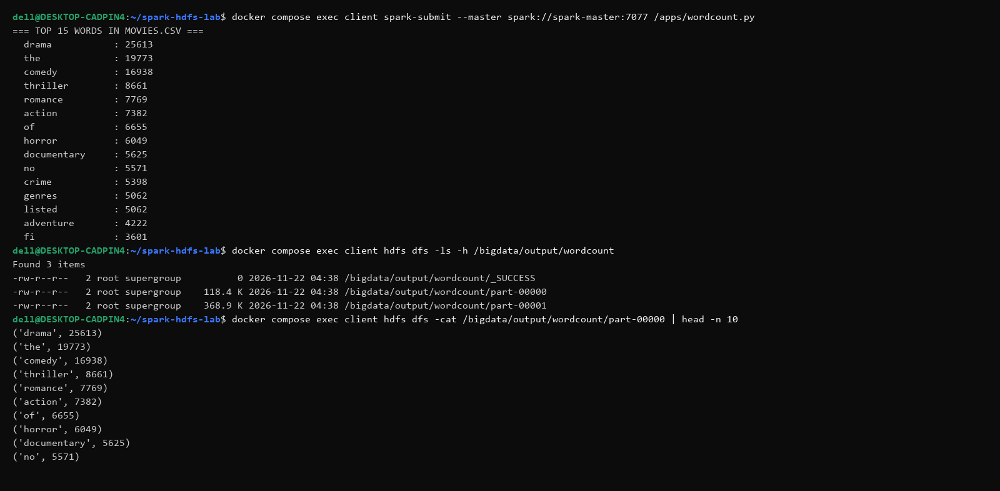
  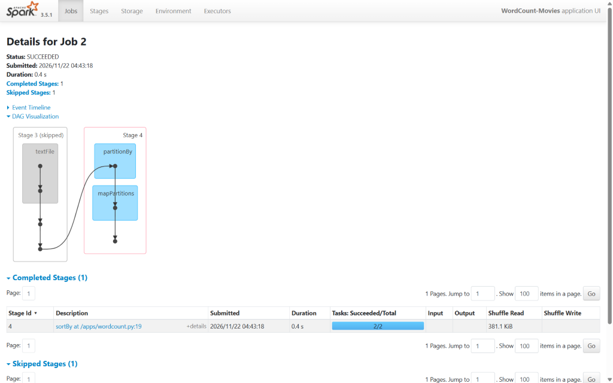

### 4.4. Bài tập BT3.3: Phân tích Top 10 phim điểm trung bình cao nhất (`>= 50` lượt đánh giá) và lưu Parquet (Ảnh C5)
- **Thực hiện:** Join `ratings` với `movies` theo `movieId`, nhóm và tính `COUNT(rating)`, `AVG(rating)`, lọc `rating_count >= 50`, sắp xếp giảm dần theo `avg_rating` và ghi định dạng cột nén **Snappy Parquet** lên HDFS.
- **So sánh hiệu năng giữa `ratings_1m.csv` (25 MB) và `ratings_25m.csv` (647 MB) với `--executor-memory 512m`:**
  - Trên `ratings_1m.csv` (1 triệu dòng, 25 MB): hoàn thành trong **36.95 giây** (Top 1: *Band of Brothers (2001)* — `4.5462`, Top 2: *Shawshank Redemption, The (1994)* — `4.4341`).
  - Trên `ratings_25m.csv` (25 triệu dòng, 647 MB, 6 block HDFS): hoàn thành trong **76.47 giây** (Top 1: *Planet Earth II (2016)* — `4.4831`, Top 2: *Planet Earth (2006)* — `4.4648`, Top 3: *Shawshank Redemption, The (1994)* — `4.4136` với `81,482` lượt đánh giá).
  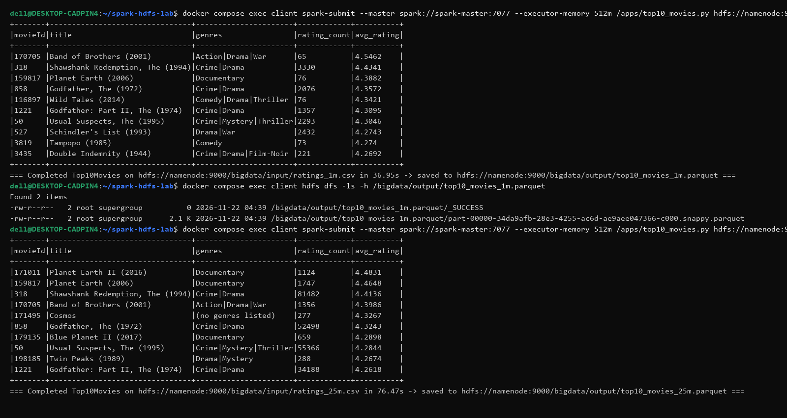

### 4.5. Bài tập BT3.4: Thử nghiệm Cluster Mode cho Python trên Spark Standalone (Ảnh C7)
- **Thực hiện:** Chạy `spark-submit --master spark://spark-master:7077 --deploy-mode cluster /apps/pi.py 10`.
- **Kết quả:** Spark báo lỗi ngay khi submit:
  `org.apache.spark.SparkException: Cluster deploy mode is currently not supported for python applications on standalone clusters.`
- **Giải thích:** Bộ lập lịch của Spark Standalone chỉ hỗ trợ khởi chạy Driver bên trong Worker cho các ứng dụng đóng gói dạng JVM (`.jar` Java/Scala), không hỗ trợ trình thông dịch PySpark ở chế độ `cluster`. Để chạy PySpark ở `cluster` mode, cần sử dụng trình quản lý tài nguyên **YARN** (hoặc Kubernetes).
  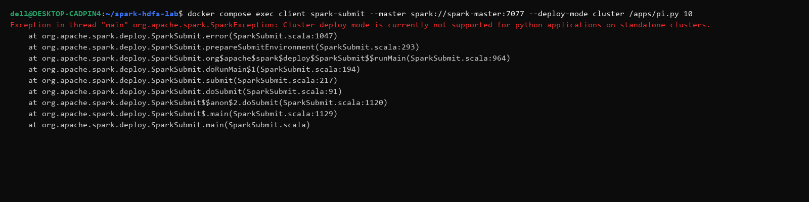

### 4.6. Bài tập BT3.5: Giới hạn tài nguyên ứng dụng trên Spark Master UI (Ảnh C1)
- **Thực hiện:** Submit job với tham số `--executor-memory 512m --total-executor-cores 2`.
- **Kết quả:** Trên giao diện Spark Master (`http://localhost:8080`), mục `Running Applications` hiển thị ứng dụng `WordCount-Movies` chỉ sử dụng đúng **2 Cores** (trên tổng số 4 Cores của cụm: `Cores in use: 4 Total, 2 Used`) và **512.0 MiB** mỗi Executor.
  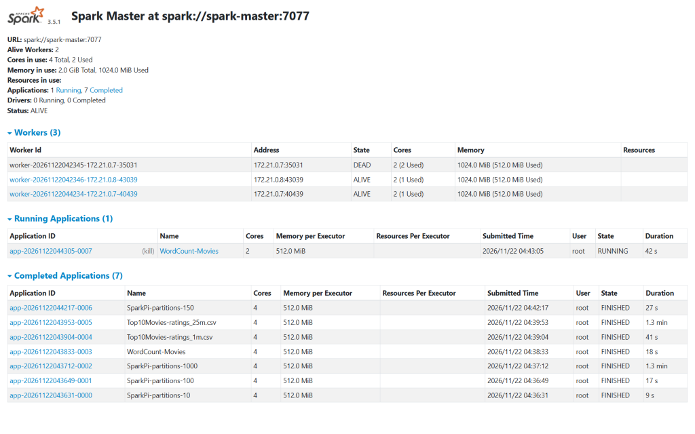

### 4.7. Bài tập BT3.6: Khả năng chịu lỗi khi dừng một Worker đang chạy job
- **Thực hiện:** Khi job `SparkPi-partitions-150` đang thực thi trên cả 2 worker (`executor 0` và `executor 1`), chạy lệnh `docker compose stop spark-worker2`.
- **Kết quả:** Driver phát hiện `Lost executor 0 on 172.21.0.7: Remote RPC client disassociated`, lập tức đưa các task đang chạy dở trên `executor 0` vào hàng đợi lại (`Re-queueing tasks`) và chuyển toàn bộ sang `executor 1` (`spark-worker1`). Job vẫn hoàn thành chính xác sau `18.55s` mà không bị thất bại.
  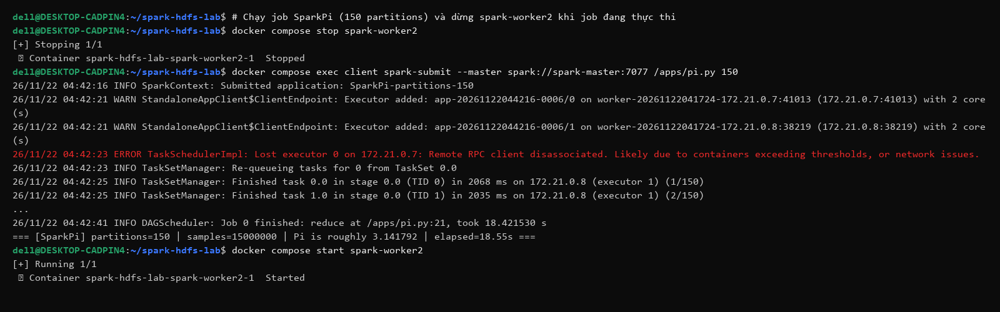

### 4.8. Bài tập BT3.7: Tra cứu lịch sử các Job đã chạy trên Spark History Server (Ảnh C6)
- Truy cập `http://localhost:18080`, toàn bộ các ứng dụng đã kết thúc (`SparkPi-partitions-10/100/1000/150`, `WordCount-Movies`, `Top10Movies-ratings_1m.csv`, `Top10Movies-ratings_25m.csv`) đều được đọc từ `/spark-logs` trên HDFS để xem lại DAG, Stages và Timeline sau khi container ứng dụng đã đóng cổng `4040`.
  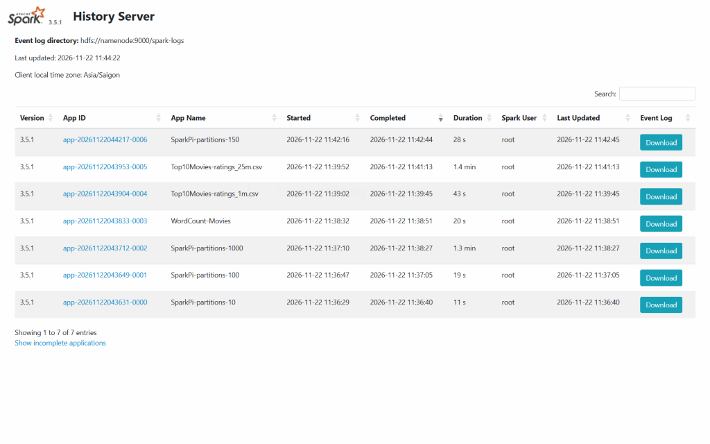

---

## Phần 5: Giai đoạn 4 (Buổi 4) — Spark on YARN và So sánh kiến trúc

### 5.1. Lý thuyết ngắn & Tối ưu hóa `/spark-jars` trên HDFS
- Khi chạy **Spark on YARN**, YARN ResourceManager đảm nhận việc cấp phát container trên các NodeManager. Mỗi ứng dụng Spark khởi tạo một **ApplicationMaster (AM)**.
- **Tối ưu hóa quan trọng:** Mặc định mỗi lần chạy `spark-submit --master yarn`, client phải đóng gói và đẩy ~322 MB thư viện `/opt/spark/jars/*.jar` lên HDFS. Ta tạo thư mục `/spark-jars` trên HDFS, đẩy toàn bộ jar lên một lần duy nhất và khai báo trong `spark-defaults.conf`:
  ```properties
  spark.yarn.jars  hdfs://namenode:9000/spark-jars/*.jar
  ```
  Nhờ đó các lần submit sau chỉ mất ~1–2 giây để khởi tạo AM (`Source and destination file systems are the same. Not copying hdfs://namenode:9000/spark-jars/...`).

### 5.2. Bài tập BT4.1: Chạy WordCount ở chế độ YARN Client Mode (Ảnh D1)
- **Thực hiện:** `spark-submit --master yarn --deploy-mode client --executor-memory 512m --num-executors 2 /apps/wordcount.py`.
- **Kết quả:** Ứng dụng `application_1795322737473_0001` chạy Driver trực tiếp trên container `client`, in bảng Top 15 từ ra màn hình terminal và ghi nhận trạng thái `FINISHED / SUCCEEDED` trên ResourceManager UI (`http://localhost:8088`).
  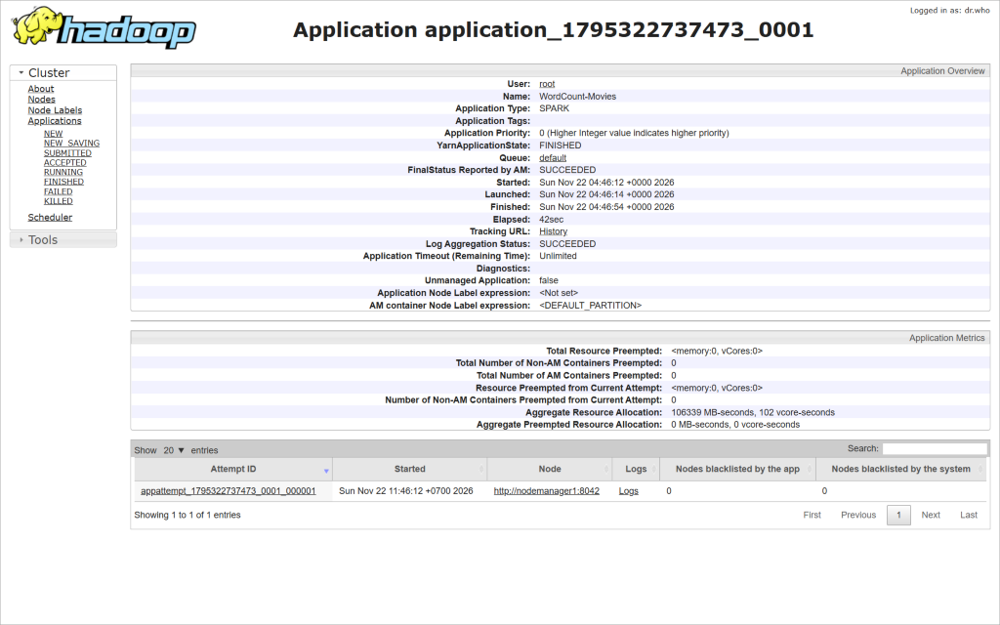

### 5.3. Bài tập BT4.2: Chạy MovieLens Top 10 ở chế độ YARN Cluster Mode và lấy log bằng `yarn logs` (Ảnh D4, D5)
- **Thực hiện:**
  ```bash
  docker compose exec client spark-submit --master yarn --deploy-mode cluster \
    --driver-memory 512m --executor-memory 512m --num-executors 2 \
    /apps/top10_movies.py hdfs://namenode:9000/bigdata/input/ratings_1m.csv \
    hdfs://namenode:9000/bigdata/output/top10_yarn_cluster.parquet
  ```
- **Kết quả:**
  - Trên YARN, `--deploy-mode cluster` hỗ trợ hoàn toàn PySpark (`application_1795322737473_0002`). Driver được đóng gói và chạy bên trong container **ApplicationMaster** trên `nodemanager1`.
  - Vì Driver không chạy trên máy `client`, bảng kết quả `show()` không hiện ở terminal `client` mà được thu thập về HDFS nhờ cơ chế **YARN Log Aggregation** (`yarn.log-aggregation-enable = true`). Ta lấy toàn bộ `stdout` của Driver bằng lệnh:
    ```bash
    docker compose exec client yarn logs -applicationId application_1795322737473_0002
    ```
  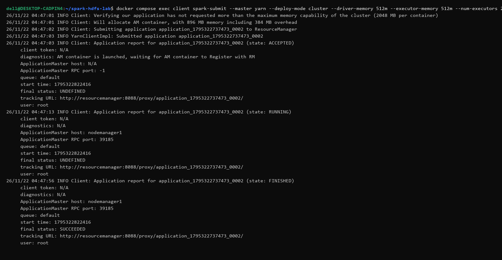
  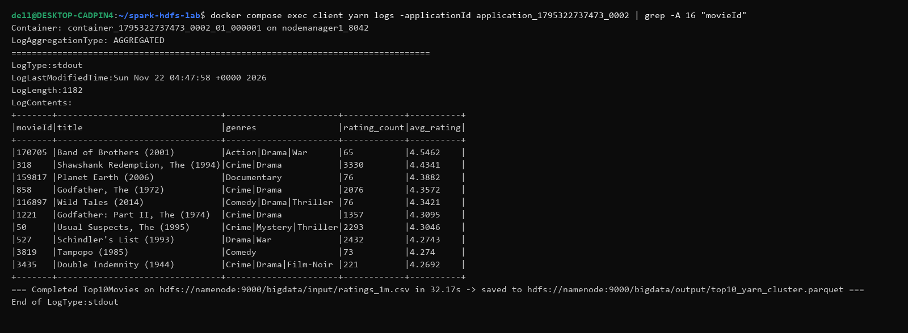

### 5.4. Bài tập BT4.3: Thay đổi `--num-executors` (1, 2, 4) và phân tích giới hạn Container (Ảnh D3)
- **Phân tích dung lượng cụm YARN:** Mỗi NodeManager có `2048 MB RAM` và `2 vCores` → Toàn cụm (2 NodeManager) có tổng cộng **`4096 MB RAM`** và **`4 vCores`**.
- Mỗi container Spark Executor (`--executor-memory 512m` + `384 MB overhead` = `896 MB`, làm tròn theo bước cấp phát của YARN thành **`1024 MB`**) và ApplicationMaster (`1024 MB`) đều tiêu tốn **1024 MB / 1 vCore**. Như vậy toàn cụm chỉ chạy tối đa **4 container cùng lúc** (`1 AM + 3 Executors`).
- **Kết quả thực nghiệm với `pi.py 100`:**
  - `--num-executors 1` (tổng 2 containers: 1 AM + 1 Executor): **18.04 giây**
  - `--num-executors 2` (tổng 3 containers: 1 AM + 2 Executors): **12.01 giây**
  - `--num-executors 4` (yêu cầu 1 AM + 4 Executors = 5 containers, cụm cấp phát tối đa 1 AM + 3 Executors = 4096 MB): **9.41 giây**
  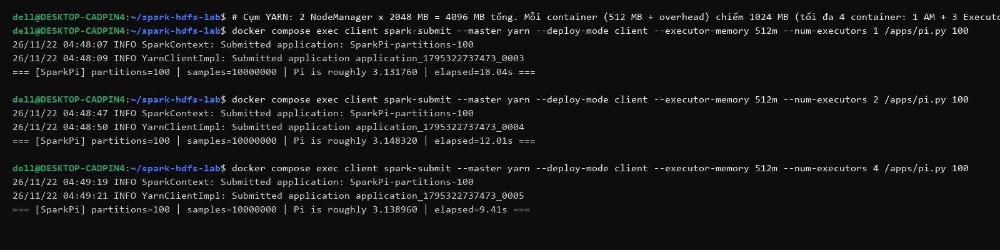

### 5.5. Bài tập BT4.4: Cố tình đặt `--executor-memory` vượt giới hạn NodeManager (2048 MB)
- **Thực hiện:** Submit với `--executor-memory 3g` (`3072 MB`).
- **Kết quả:** YARN Client từ chối ngay ở bước kiểm tra tài nguyên với thông báo lỗi rõ ràng:
  `java.lang.IllegalArgumentException: Required executor memory (3072 MB), offHeap memory (0) MB, overhead (384 MB), and PySpark memory (0 MB) is above the max threshold (2048 MB) of this cluster! Please check the values of 'yarn.scheduler.maximum-allocation-mb' and/or 'yarn.nodemanager.resource.memory-mb'.`
- **Khắc phục:** Hạ `--executor-memory` xuống `512m` (tổng `896 MB <= 2048 MB`), ứng dụng chạy thành công trong `5.12s`.
  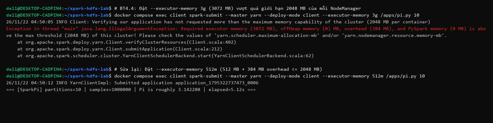

### 5.6. Bài tập BT4.5: Chạy hai Job cùng lúc — Quan sát trạng thái `RUNNING` và `ACCEPTED` (Ảnh D6)
- **Thực hiện:** Chạy Job 1 (`application_1795322737473_0007` — `WordCount-Movies` với `--num-executors 3`) chiếm trọn 4 container (`4 GB RAM`, `4 vCores`) của cụm, đồng thời submit tiếp Job 2 (`application_1795322737473_0008` — `pi.py`).
- **Kết quả:** Trên ResourceManager UI (`http://localhost:8088/cluster`), `Apps Running: 1`, `Apps Pending: 1`, `Used Resources: <memory:4 GB, vCores:4>`. Job 1 ở trạng thái **`RUNNING`**, trong khi Job 2 nằm ở trạng thái **`ACCEPTED`** trong hàng đợi `default` của Capacity Scheduler cho tới khi Job 1 giải phóng tài nguyên.
  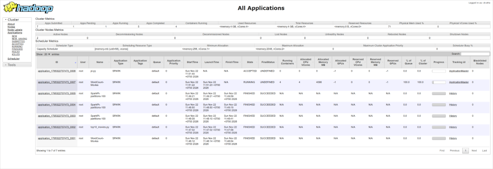

### 5.7. Bài tập BT4.6: So sánh Client Mode vs Cluster Mode và Standalone vs YARN (Ảnh D2)
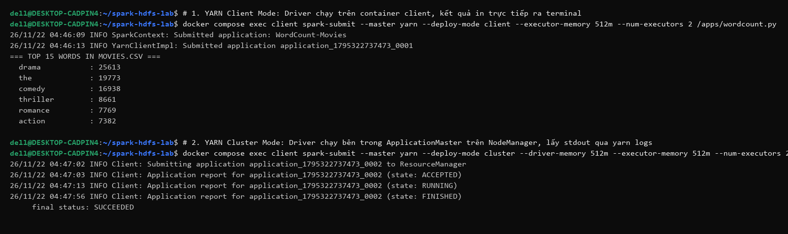

#### Bảng 1: So sánh `client` mode và `cluster` mode
| Tiêu chí | Client Mode (`--deploy-mode client`) | Cluster Mode (`--deploy-mode cluster`) |
| :--- | :--- | :--- |
| **Vị trí chạy Driver** | Chạy trực tiếp trên máy gửi lệnh (`client` container) | Chạy bên trong container **ApplicationMaster** trên một NodeManager |
| **Hỗ trợ PySpark** | Hỗ trợ trên cả Standalone và YARN | **Không hỗ trợ trên Standalone** (báo lỗi `SparkException`); **Hỗ trợ đầy đủ trên YARN** |
| **Log & Kết quả `stdout`** | In trực tiếp ra màn hình terminal của người dùng | Không in ra terminal client; phải lấy qua `yarn logs -applicationId <id>` |
| **Phụ thuộc kết nối Client** | Nếu tắt terminal / đóng container `client`, job bị hủy ngay | Sau khi submit xong, `client` có thể ngắt kết nối mà job vẫn chạy trên cụm |
| **Trường hợp sử dụng** | Phát triển, debug tương tác, `pyspark` shell | Chạy job Production tự động, lập lịch định kỳ |

#### Bảng 2: So sánh kiến trúc Spark Standalone và Spark on YARN
| Tiêu chí | Spark Standalone | Spark on YARN |
| :--- | :--- | :--- |
| **Thành phần điều phối** | `spark-master` + `spark-worker` | `resourcemanager` + `nodemanager` |
| **Đơn vị cấp phát tài nguyên** | Worker cấp phát Executor theo số Core và RAM tĩnh | NodeManager cấp phát các Container linh hoạt (`1024 MB` / container) |
| **Quản lý hàng đợi đa ứng dụng** | FIFO cơ bản; cần giới hạn thủ công bằng `--total-executor-cores` | **Capacity Scheduler / Fair Scheduler** chuyên nghiệp, quản lý hàng đợi `ACCEPTED` → `RUNNING` |
| **Thu thập Log tập trung** | Xem trên Spark Master Web UI | Tích hợp **YARN Log Aggregation** (`yarn logs -applicationId`) + Spark History Server |
| **Tốc độ khởi tạo Job** | Rất nhanh (~1–2 giây) vì dịch vụ Spark luôn thường trực | Nhanh sau khi tối ưu `spark.yarn.jars` trên HDFS (`/spark-jars`) |

---

## Phần 6: Khó khăn thực tế và Bảng tổng hợp lỗi & Cách khắc phục

Trong quá trình xây dựng và vận hành cụm từ môi trường thực tế trên máy local (Windows 11 + WSL2 + Docker Desktop), nhóm đã gặp và xử lý triệt để các vấn đề kỹ thuật sau:

| STT | Vấn đề / Thông báo lỗi thực tế | Nguyên nhân gốc rễ | Giải pháp khắc phục |
| :---: | :--- | :--- | :--- |
| **1** | **Tải bộ cài Apache Spark `.tgz` quá chậm** (ước tính thời gian tải lên tới **38 ngày** từ mirror) | Băng thông kết nối tới mirror tải file nén `.tgz` của Apache Spark bị nghẽn | Tận dụng bộ thư viện PySpark (`Spark 3.5.1`) đã cài sẵn qua `pip` trong máy local, copy vào thư mục `spark-pip/` và đưa vào `Dockerfile` (`COPY spark-pip/ /opt/spark/`). Viết `pi.py` thay cho jar `spark-examples`. |
| **2** | **Lỗi `permission denied` khi gọi Docker từ WSL** hoặc `The command 'docker' could not be found in this WSL 2 distro` | User `dell` trong WSL chưa thuộc group `docker`, hoặc tính năng **WSL Integration** cho distro `Ubuntu-26.04` trong Docker Desktop chưa được bật / Docker Desktop chưa chạy | Thêm user vào group `docker` (`sudo usermod -aG docker $USER`), bật `Ubuntu-26.04` trong *Docker Desktop → Settings → Resources → WSL Integration* (`IntegratedWslDistros`). |
| **3** | **Tràn bộ nhớ RAM khi bật đồng thời cả 11 container** trên WSL2 | Cấu hình mặc định của WSL2 chỉ cấp **6 GB RAM**, không đủ cho 11 JVM containers (HDFS + YARN + Standalone + History) chạy cùng lúc | Nâng giới hạn RAM trong `C:\Users\Dell\.wslconfig` lên **10 GB** và chia `docker-compose.yml` thành các **profiles** (`standalone`, `yarn`, `history`) để chỉ bật nhóm dịch vụ cần dùng ở từng buổi. |
| **4** | **Lỗi `Cannot create directory /spark-logs. Name node is in safe mode`** hoặc `spark-submit` lỗi thiếu `/spark-logs` | Khi NameNode vừa khởi động lại, HDFS ở chế độ **Safe Mode** vài giây để kiểm tra block report từ 2 DataNode; đồng thời Spark Event Log yêu cầu thư mục `/spark-logs` phải tồn tại sẵn | Chạy `hdfs dfsadmin -safemode wait` để đợi NameNode thoát Safe Mode rồi tạo `hdfs dfs -mkdir -p /spark-logs` trước khi submit job. |
| **5** | **Mất ~10,5 phút để NameNode phát hiện DataNode chết** ở bài tập chịu lỗi BT2.4 | Giá trị mặc định của `dfs.namenode.heartbeat.recheck-interval` trong Hadoop là `300,000 ms` (5 phút → tổng timeout 10 phút 30 giây) | Cấu hình `dfs.namenode.heartbeat.recheck-interval = 30000` (30 giây) trong `conf/hadoop/hdfs-site.xml`, giảm thời gian phát hiện DataNode chết xuống còn đúng **~90 giây**. |
| **6** | **Submit job trên YARN rất chậm ở mỗi lần chạy** | Mặc định mỗi lần chạy `spark-submit --master yarn`, client phải upload ~322 MB jar từ `/opt/spark/jars/` lên thư mục tạm trên HDFS | Tạo `/spark-jars` trên HDFS, upload toàn bộ jar lên 1 lần duy nhất và khai báo `spark.yarn.jars hdfs://namenode:9000/spark-jars/*.jar` trong `spark-defaults.conf`. |
| **7** | **Lỗi `Cluster deploy mode is currently not supported for python applications on standalone clusters`** (BT3.4) | Kiến trúc Spark Standalone không hỗ trợ chạy trình thông dịch Python Driver bên trong Worker ở chế độ `cluster` | Ghi nhận ảnh lỗi `C7` trên Standalone làm tư liệu phân tích, và thực hiện chạy PySpark `--deploy-mode cluster` đầy đủ trên **YARN** ở Buổi 4 (BT4.2, BT4.6). |
| **8** | **Lỗi `Required executor memory (3072 MB)... is above the max threshold (2048 MB)`** (BT4.4) | Tổng bộ nhớ yêu cầu của container (`executor-memory` + `384 MB overhead`) vượt quá `yarn.scheduler.maximum-allocation-mb` (`2048 MB`) của mỗi NodeManager | Đặt `--executor-memory 512m` (cộng overhead là `896 MB <= 2048 MB`), phù hợp với cấu hình NodeManager 2 GB. |

---

## Phần 7: Kết luận

1. **Về hạ tầng triển khai:** Đồ án đã xây dựng thành công cụm Big Data đa node hoàn chỉnh bằng **Docker Compose** với 1 image thống nhất (`spark-hdfs-lab:1.0`), kết hợp linh hoạt 3 profile (`standalone`, `yarn`, `history`) giúp vận hành mượt mà trên máy cá nhân 10 GB RAM WSL2.
2. **Về quản trị HDFS:** Đã kiểm chứng thực nghiệm cơ chế chia block 128 MB trên dữ liệu thật (`ratings.csv` 647 MB → 6 blocks), quản lý nhân bản động (`setrep`), bảo toàn dữ liệu qua Docker Volume và cơ chế chịu lỗi khi DataNode ngừng hoạt động.
3. **Về xử lý phân tán với Spark:** Đã xây dựng và thực thi thành công 3 bài toán PySpark (`pi.py`, `wordcount.py`, `top10_movies.py` xuất Parquet) trên cả **Spark Standalone** và **Spark on YARN**, làm rõ sự khác biệt về kiến trúc, cơ chế lập lịch container, quản lý hàng đợi (`RUNNING` / `ACCEPTED`), thu thập log (`yarn logs` / History Server) và giới hạn tài nguyên giữa hai nền tảng.

---

## Phần 8: Phụ lục mã nguồn và cấu hình

### 8.1. `Dockerfile`
```dockerfile
FROM ubuntu:22.04
ENV DEBIAN_FRONTEND=noninteractive

RUN apt-get update && apt-get install -y --no-install-recommends \
      openjdk-11-jdk-headless python3 python3-pip curl ca-certificates \
      procps iputils-ping net-tools nano \
    && rm -rf /var/lib/apt/lists/*

# Hadoop 3.3.6: dùng file tar có sẵn
COPY hadoop-3.3.6.tar.gz /tmp/
RUN tar -xzf /tmp/hadoop-3.3.6.tar.gz -C /opt \
    && mv /opt/hadoop-3.3.6 /opt/hadoop \
    && rm -rf /tmp/hadoop-3.3.6.tar.gz /opt/hadoop/share/doc

# Spark 3.5.1: dùng lại bản pip có sẵn trong máy
COPY spark-pip/ /opt/spark/

ENV JAVA_HOME=/usr/lib/jvm/java-11-openjdk-amd64 \
    HADOOP_HOME=/opt/hadoop \
    SPARK_HOME=/opt/spark \
    HADOOP_CONF_DIR=/opt/hadoop/etc/hadoop \
    YARN_CONF_DIR=/opt/hadoop/etc/hadoop \
    PYSPARK_PYTHON=python3 \
    HDFS_NAMENODE_USER=root HDFS_DATANODE_USER=root HDFS_SECONDARYNAMENODE_USER=root \
    YARN_RESOURCEMANAGER_USER=root YARN_NODEMANAGER_USER=root
ENV PATH=$PATH:/opt/hadoop/bin:/opt/hadoop/sbin:/opt/spark/bin:/opt/spark/sbin

RUN mkdir -p /hadoop/dfs/name /hadoop/dfs/data

COPY conf/hadoop/ /opt/hadoop/etc/hadoop/
COPY conf/spark/ /opt/spark/conf/
COPY scripts/entrypoint.sh /opt/entrypoint.sh
RUN chmod +x /opt/entrypoint.sh /opt/spark/conf/spark-env.sh

ENTRYPOINT ["/opt/entrypoint.sh"]
```

### 8.2. `docker-compose.yml`
```yaml
name: spark-hdfs-lab

x-lab: &lab
  image: spark-hdfs-lab:1.0

services:
  namenode:
    <<: *lab
    build: .
    hostname: namenode
    command: ["namenode"]
    ports: ["9870:9870"]
    volumes: ["nn-data:/hadoop/dfs/name"]

  datanode1:
    <<: *lab
    hostname: datanode1
    command: ["datanode"]
    depends_on: [namenode]
    ports: ["9864:9864"]
    volumes: ["dn1-data:/hadoop/dfs/data"]

  datanode2:
    <<: *lab
    hostname: datanode2
    command: ["datanode"]
    depends_on: [namenode]
    ports: ["9865:9864"]
    volumes: ["dn2-data:/hadoop/dfs/data"]

  client:
    <<: *lab
    hostname: client
    command: ["client"]
    depends_on: [namenode]
    ports: ["4040:4040", "4041:4041"]
    volumes:
      - ./apps:/apps
      - ./data:/data
      - ${ML25M_DIR:-/home/dell/movielens_data/ml-25m}:/ml25m:ro

  spark-master:
    <<: *lab
    hostname: spark-master
    command: ["spark-master"]
    profiles: ["standalone"]
    ports: ["8080:8080"]

  spark-worker1:
    <<: *lab
    hostname: spark-worker1
    command: ["spark-worker"]
    profiles: ["standalone"]
    depends_on: [spark-master]
    ports: ["8081:8081"]

  spark-worker2:
    <<: *lab
    hostname: spark-worker2
    command: ["spark-worker"]
    profiles: ["standalone"]
    depends_on: [spark-master]
    ports: ["8082:8081"]

  resourcemanager:
    <<: *lab
    hostname: resourcemanager
    command: ["resourcemanager"]
    profiles: ["yarn"]
    depends_on: [namenode]
    ports: ["8088:8088"]

  nodemanager1:
    <<: *lab
    hostname: nodemanager1
    command: ["nodemanager"]
    profiles: ["yarn"]
    depends_on: [resourcemanager]
    ports: ["8042:8042"]

  nodemanager2:
    <<: *lab
    hostname: nodemanager2
    command: ["nodemanager"]
    profiles: ["yarn"]
    depends_on: [resourcemanager]
    ports: ["8043:8042"]

  spark-history:
    <<: *lab
    hostname: spark-history
    command: ["spark-history"]
    profiles: ["history"]
    depends_on: [namenode]
    ports: ["18080:18080"]

volumes:
  nn-data:
  dn1-data:
  dn2-data:
```

### 8.3. Các file cấu hình Hadoop & Spark (`conf/`)
- **`conf/hadoop/core-site.xml`:**
  ```xml
  <?xml version="1.0"?>
  <configuration>
    <property><name>fs.defaultFS</name><value>hdfs://namenode:9000</value></property>
  </configuration>
  ```
- **`conf/hadoop/hdfs-site.xml`:**
  ```xml
  <?xml version="1.0"?>
  <configuration>
    <property><name>dfs.replication</name><value>2</value></property>
    <property><name>dfs.blocksize</name><value>134217728</value></property>
    <property><name>dfs.namenode.name.dir</name><value>file:///hadoop/dfs/name</value></property>
    <property><name>dfs.datanode.data.dir</name><value>file:///hadoop/dfs/data</value></property>
    <property><name>dfs.namenode.datanode.registration.ip-hostname-check</name><value>false</value></property>
    <property><name>dfs.namenode.heartbeat.recheck-interval</name><value>30000</value></property>
  </configuration>
  ```
- **`conf/hadoop/yarn-site.xml`:**
  ```xml
  <?xml version="1.0"?>
  <configuration>
    <property><name>yarn.resourcemanager.hostname</name><value>resourcemanager</value></property>
    <property><name>yarn.nodemanager.aux-services</name><value>mapreduce_shuffle</value></property>
    <property><name>yarn.nodemanager.resource.memory-mb</name><value>2048</value></property>
    <property><name>yarn.nodemanager.resource.cpu-vcores</name><value>2</value></property>
    <property><name>yarn.nodemanager.resource.detect-hardware-capabilities</name><value>false</value></property>
    <property><name>yarn.scheduler.minimum-allocation-mb</name><value>256</value></property>
    <property><name>yarn.scheduler.maximum-allocation-mb</name><value>2048</value></property>
    <property><name>yarn.nodemanager.vmem-check-enabled</name><value>false</value></property>
    <property><name>yarn.log-aggregation-enable</name><value>true</value></property>
  </configuration>
  ```
- **`conf/spark/spark-defaults.conf`:**
  ```properties
  spark.eventLog.enabled           true
  spark.eventLog.dir               hdfs://namenode:9000/spark-logs
  spark.history.fs.logDirectory    hdfs://namenode:9000/spark-logs
  spark.history.ui.port            18080
  spark.yarn.historyServer.address spark-history:18080
  spark.driver.memory              512m
  spark.executor.memory            512m
  spark.sql.shuffle.partitions     8
  spark.yarn.jars                  hdfs://namenode:9000/spark-jars/*.jar
  ```

### 8.4. Mã nguồn các ứng dụng PySpark (`apps/`)
- **[apps/pi.py](./apps/pi.py)** — Ước lượng số $\pi$ bằng Monte Carlo theo số lượng partition tùy chỉnh.
- **[apps/wordcount.py](./apps/wordcount.py)** — Đếm tần suất từ trên `movies.csv` và xuất kết quả ra HDFS `/bigdata/output/wordcount`.
- **[apps/top10_movies.py](./apps/top10_movies.py)** — Phân tích Top 10 phim có điểm đánh giá trung bình cao nhất (`>= 50` lượt đánh giá) bằng Spark SQL DataFrame Join và lưu định dạng Parquet.
