# TRIỂN KHAI CỤM SPARK VÀ QUẢN LÝ DỮ LIỆU TRÊN HDFS BẰNG DOCKER COMPOSE

**Học phần:** Công nghệ Dữ liệu lớn (Big Data)  
**Đơn vị:** Trường Đại học Công Thương TP. Hồ Chí Minh (HUIT) – Khoa Công nghệ thông tin  

| Vai trò | Họ và tên | MSSV |
| :--- | :--- | :--- |
| **Giảng viên hướng dẫn** | ThS. Nguyễn Quang Huy | |
| **Sinh viên thực hiện** | Nguyễn Hoàng Thành | |
| **Sinh viên thực hiện** | Phan Trần Hữu Duy | 2001230128 |

---

## MỤC LỤC HƯỚNG DẪN
1. [Kiến trúc cụm và Cấu trúc thư mục](#1-kiến-trúc-cụm-và-cấu-trúc-thư-mục)
2. [Hướng dẫn cài đặt & chuẩn bị môi trường](#2-hướng-dẫn-cài-đặt--chuẩn-bị-môi-trường)
3. [Chương 1: Triển khai hệ thống bằng Docker Compose (Khởi chạy, Web UI, BT1.2)](#3-chương-1-triển-khai-hệ-thống-bằng-docker-compose)
4. [Chương 2: Quản lý dữ liệu trên HDFS (BT2.1, BT2.2, BT2.4, BT2.6)](#4-chương-2-quản-lý-dữ-liệu-trên-hdfs)
5. [Chương 3: Thực thi ứng dụng Spark trên cụm Standalone (BT3.1, BT3.2, BT3.3, BT3.4, BT3.7)](#5-chương-3-thực-thi-ứng-dụng-spark-trên-cụm-standalone)
6. [Chương 4: Thực thi ứng dụng Spark trên YARN (BT4.1, BT4.2, BT4.6)](#6-chương-4-thực-thi-ứng-dụng-spark-trên-yarn)
7. [Dừng cụm và Xử lý sự cố thường gặp](#7-dừng-cụm-và-xử-lý-sự-cố-thường-gặp)

---

## 1. Kiến trúc cụm và Cấu trúc thư mục

### 1.1. Kiến trúc cụm 11 dịch vụ theo Docker Compose Profiles
Hệ thống được đóng gói trên một image duy nhất (`spark-hdfs-lab:1.0`, tích hợp **Ubuntu 22.04**, **OpenJDK 11**, **Apache Hadoop 3.3.6** và **Apache Spark 3.5.1**). Cụm gồm **11 dịch vụ** chia thành **4 nhóm (Profiles)** để tối ưu hóa bộ nhớ RAM:

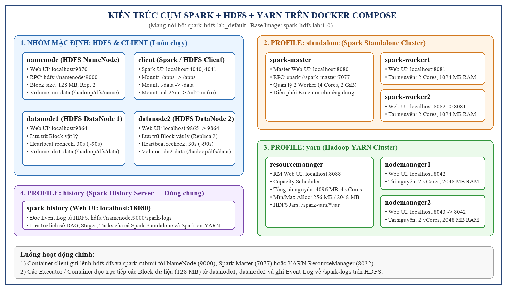

| Nhóm / Profile | Tên dịch vụ | Cổng (Host:Container) | Vai trò và tài nguyên chính |
| :--- | :--- | :--- | :--- |
| **Mặc định** *(HDFS & Client)* | `namenode` | `9870:9870`, `9000:9000` | Quản lý metadata HDFS; block `128 MB`, `replication = 2`, volume `nn-data` |
| **Mặc định** | `datanode1`, `datanode2` | `9864:9864`, `9865:9864` | Lưu trữ block vật lý; gắn volume `dn1-data`, `dn2-data` |
| **Mặc định** | `client` | `4040:4040`, `4041:4041` | Nút chạy lệnh `hdfs dfs`, `spark-submit`; mount `/apps`, `/data`, `/ml25m` |
| **`standalone`** | `spark-master` | `8080:8080`, `7077:7077` | Điều phối cụm Spark Standalone (`spark://spark-master:7077`) |
| **`standalone`** | `spark-worker1`, `spark-worker2` | `8081:8081`, `8082:8081` | Mỗi Worker cấp phát `2 Cores`, `1024 MB RAM` |
| **`yarn`** | `resourcemanager` | `8088:8088`, `8032:8032` | Quản lý tài nguyên YARN (`Capacity Scheduler`, tổng `4096 MB`, `4 vCores`) |
| **`yarn`** | `nodemanager1`, `nodemanager2` | `8042:8042`, `8043:8042` | Mỗi NodeManager cấp phát `2 vCores`, `2048 MB RAM` |
| **`history`** | `spark-history` | `18080:18080` | Đọc event log từ `hdfs://namenode:9000/spark-logs` |

### 1.2. Cấu trúc thư mục dự án
```text
spark-hdfs-lab/
├── docker-compose.yml              # Định nghĩa 11 container theo 3 profiles (standalone, yarn, history)
├── Dockerfile                      # Cấu hình build image spark-hdfs-lab:1.0
├── conf/
│   ├── hadoop/                     # core-site.xml, hdfs-site.xml, mapred-site.xml, yarn-site.xml
│   └── spark/                      # spark-defaults.conf, spark-env.sh
├── scripts/
│   ├── entrypoint.sh               # Kịch bản khởi động theo vai trò từng container
│   └── prepare_build.sh            # Tự động tải Hadoop 3.3.6 & trích xuất Spark 3.5.1 để build image
├── apps/
│   ├── pi.py                       # Ví dụ 1 & BT3.1: Ước lượng số Pi (Monte Carlo) theo số lượng Partition
│   ├── wordcount.py                # Ví dụ 2, BT3.2 & BT4.1: Đếm từ trên movies.csv, lưu HDFS
│   └── top10_movies.py             # BT3.3 & BT4.2: Top 10 phim điểm cao nhất (>= 50 đánh giá), xuất Parquet
├── data/
│   ├── movies.csv                  # Danh mục phim MovieLens (~3 MB)
│   └── ratings_1m.csv              # Tập dữ liệu 1 triệu lượt đánh giá (~25 MB)
└── screenshots/                    # Bộ ảnh minh chứng kết quả thực nghiệm (A0 -> D6)
```

---

## 2. Hướng dẫn cài đặt & chuẩn bị môi trường

### Yêu cầu hệ thống
- **Docker** và **Docker Compose** (trên Windows khuyến nghị dùng **Docker Desktop** tích hợp **WSL2**, cấp tối thiểu `8–10 GB RAM` trong `.wslconfig`).
- **Python 3** (nếu dùng script `prepare_build.sh` để tự build image từ đầu).

### Bước 1: Tải mã nguồn dự án
```bash
git clone https://github.com/Duy35P/TH_BigData_BaiNhom_Lab2.git
cd TH_BigData_BaiNhom_Lab2
```
*(Hoặc giải nén từ gói `spark-hdfs-lab-package.zip`).*

### Bước 2: Chuẩn bị Docker Image `spark-hdfs-lab:1.0` (Chọn 1 trong 2 cách)

#### Cách A: Nạp từ file image đóng gói sẵn (`spark-hdfs-lab-image.tar.gz`) — *Nhanh nhất (~10 giây, không cần build)*
```bash
docker load -i spark-hdfs-lab-image.tar.gz
```

#### Cách B: Tự build image từ `Dockerfile`
Chạy script tự động tải `hadoop-3.3.6.tar.gz` và trích xuất `pyspark==3.5.1` vào thư mục `spark-pip/`, sau đó build image:
```bash
bash scripts/prepare_build.sh
docker compose build
```

### Bước 3: Chuẩn bị dữ liệu đầu vào (`data/`)
- Nếu giải nén từ `spark-hdfs-lab-package.zip`, thư mục `data/` đã có sẵn `movies.csv` (3 MB) và `ratings_1m.csv` (25 MB).
- Nếu clone từ GitHub và muốn dùng bộ dữ liệu lớn **MovieLens 25M** (`ratings.csv` ~647 MB cho bài chia 6 block 128 MB), tải bộ `ml-25m.zip` từ [GroupLens MovieLens 25M](https://grouplens.org/datasets/movielens/25m/), giải nén vào `./data` (hoặc đặt biến môi trường `export ML25M_DIR=/đường/dẫn/tới/ml-25m`).

---

## 3. CHƯƠNG 1: Triển khai hệ thống bằng Docker Compose

### 3.1. Khởi chạy cụm và kiểm tra Web UI
1. **Khởi chạy đồng thời các dịch vụ HDFS, Standalone và YARN:**
   ```bash
   docker compose --profile standalone --profile yarn up -d
   docker compose ps
   ```
   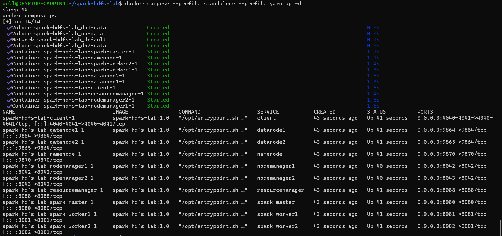

2. **Mở trình duyệt kiểm tra 3 giao diện quản trị Web UI:**
   - **HDFS NameNode (`http://localhost:9870`):** Trạng thái `Active`, `Safemode is off`, nhận đủ `Live Nodes: 2` (`datanode1`, `datanode2`).
     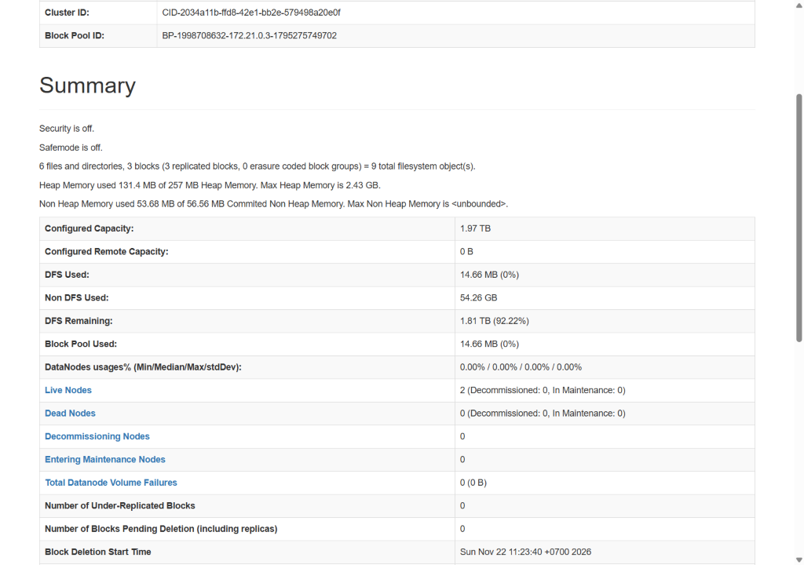
   - **YARN ResourceManager (`http://localhost:8088/cluster`):** Hiển thị `Active Nodes: 2`, tổng tài nguyên `4 GB RAM` và `4 vCores`.
     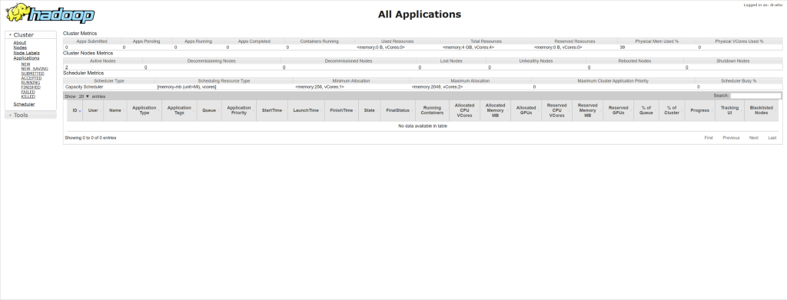
   - **Spark Master (`http://localhost:8080`):** Hiển thị `Alive Workers: 2`, tổng `4 Cores` và `2.0 GiB RAM`.
     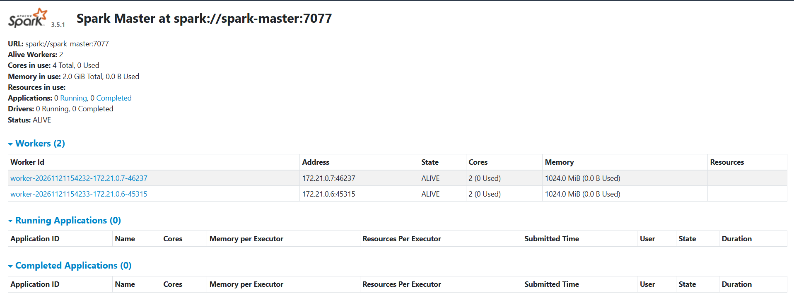

### 3.2. Bài tập BT1.2: Kiểm chứng tính bền vững dữ liệu qua Docker Volume
1. **Tạo thư mục `/user/student` và tải `movies.csv` (2.9 MB) lên HDFS:**
   ```bash
   docker compose exec client hdfs dfs -mkdir -p /user/student
   docker compose exec client hdfs dfs -put -f /data/movies.csv /user/student/movies.csv
   docker compose exec client hdfs dfs -ls -h /user/student
   ```
2. **Hủy toàn bộ container (`down`), sau đó khởi động lại cụm (`up -d`) và kiểm tra lại tập tin:**
   ```bash
   docker compose --profile standalone --profile yarn down
   docker compose --profile standalone --profile yarn up -d
   docker compose exec client hdfs dfs -ls -h /user/student
   docker compose exec client hdfs dfs -cat /user/student/movies.csv | head -n 5
   ```
   > **Kết quả:** Tập tin `/user/student/movies.csv` vẫn tồn tại nguyên vẹn nhờ 3 Docker Named Volumes (`nn-data`, `dn1-data`, `dn2-data`) và cơ chế kiểm tra không format lại NameNode trong `scripts/entrypoint.sh`.

   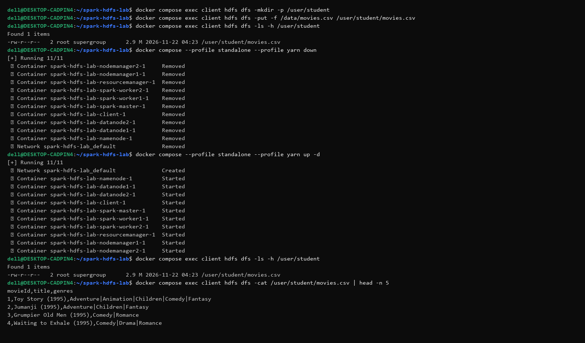

---

## 4. CHƯƠNG 2: Quản lý dữ liệu trên HDFS

### 4.1. Bài tập BT2.1: Thao tác cây thư mục và tập tin trên HDFS
Tạo cây thư mục `/bigdata/input`, `/bigdata/backup`, `/bigdata/temp`; nạp dữ liệu MovieLens (`movies.csv`, `ratings_1m.csv`); thực hiện sao chép (`cp`), đổi tên (`mv`) và xóa thư mục tạm (`rm -r`):
```bash
docker compose exec client hdfs dfs -mkdir -p /bigdata/input /bigdata/backup /bigdata/temp
docker compose exec client hdfs dfs -put -f /data/movies.csv /bigdata/input/movies.csv
docker compose exec client hdfs dfs -put -f /data/ratings_1m.csv /bigdata/input/ratings_1m.csv
docker compose exec client hdfs dfs -cp /bigdata/input/movies.csv /bigdata/backup/movies_bak.csv
docker compose exec client hdfs dfs -mv /bigdata/backup/movies_bak.csv /bigdata/backup/movies_2026.csv
docker compose exec client hdfs dfs -put -f /data/movies.csv /bigdata/temp/to_delete.csv
docker compose exec client hdfs dfs -ls -R -h /bigdata
docker compose exec client hdfs dfs -rm -r /bigdata/temp
docker compose exec client hdfs dfs -ls -R -h /bigdata
```
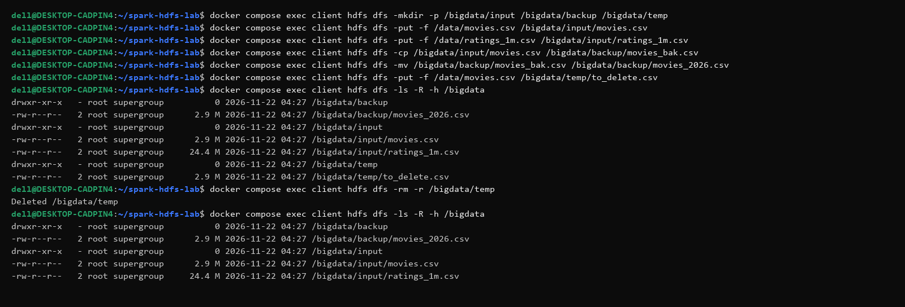

### 4.2. Bài tập BT2.2 & BT2.6: Kiểm tra chia Block 128 MB trên dữ liệu lớn (647 MB)
1. **Tải tập tin `ratings.csv` (646.8 MB, 25 triệu dòng đánh giá) lên HDFS và kiểm tra danh sách Block bằng `hdfs fsck`:**
   ```bash
   docker compose exec client hdfs dfs -put -f /ml25m/ratings.csv /bigdata/input/ratings_25m.csv
   docker compose exec client hdfs dfs -ls -h /bigdata/input/ratings_25m.csv
   docker compose exec client hdfs fsck /bigdata/input/ratings_25m.csv -files -blocks -locations
   ```
   > **Kết quả:** Tập tin `678,260,987 bytes` được cắt thành **6 Blocks** (5 block đầu đúng `128 MB` và Block 5 là `6.84 MB`), trạng thái `HEALTHY`, mỗi block có `Live_repl=2` trên cả `datanode1` và `datanode2`.

   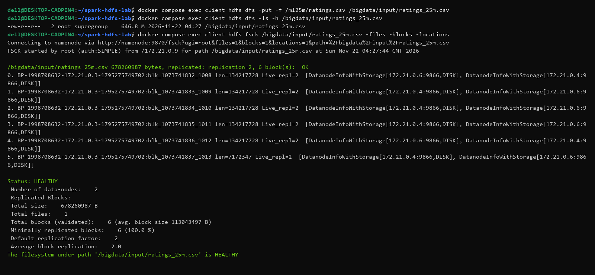

2. **Duyệt tập tin trên NameNode Web UI (`http://localhost:9870/explorer.html#/bigdata/input`):**
   Nhấp vào `ratings_25m.csv` để xem hộp thoại **File Information** hiển thị trực quan từ `Block 0` đến `Block 5`.
   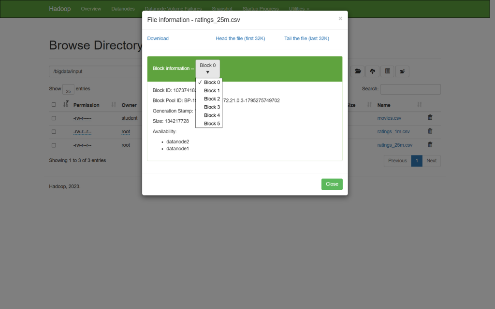

### 4.3. Bài tập BT2.4: Kiểm thử khả năng chịu lỗi khi DataNode ngừng hoạt động
*(Cụm đã cấu hình `dfs.namenode.heartbeat.recheck-interval = 30000` trong `conf/hadoop/hdfs-site.xml` để rút ngắn thời gian phát hiện nút chết xuống còn **~90 giây** thay vì 10,5 phút mặc định).*

1. **Dừng `datanode2`, chờ ~90 giây và kiểm tra báo cáo hệ thống:**
   ```bash
   docker compose stop datanode2
   sleep 95
   docker compose exec client hdfs dfsadmin -report
   docker compose exec client hdfs fsck /bigdata/input/ratings_25m.csv -files -blocks -locations
   ```
   > **Kết quả khi tắt `datanode2`:** Báo cáo ghi nhận `Live datanodes (1)`, `Dead datanodes (1)` và cả 6/6 block chuyển sang cảnh báo `Under replicated` (`Live_repl=1`), nhưng tập tin vẫn ở trạng thái `HEALTHY` và đọc bình thường từ `datanode1`.

   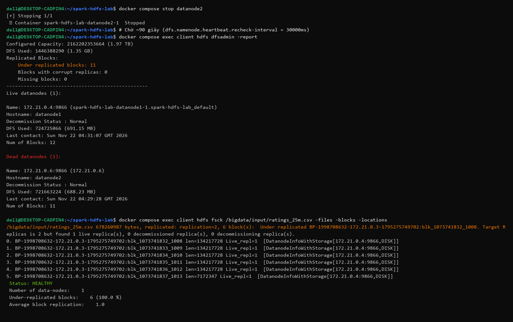

2. **Khởi động lại `datanode2` và kiểm tra trạng thái tự phục hồi:**
   ```bash
   docker compose start datanode2
   sleep 10
   docker compose exec client hdfs dfsadmin -report
   docker compose exec client hdfs fsck /bigdata/input/ratings_25m.csv -files -blocks -locations
   ```
   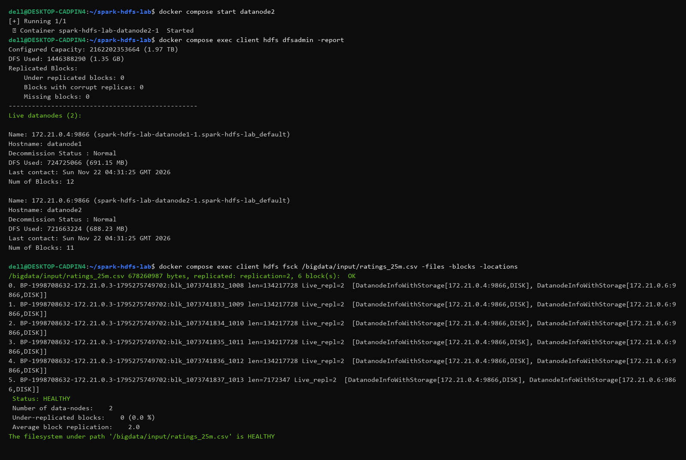

---

## 5. CHƯƠNG 3: Thực thi ứng dụng Spark trên cụm Standalone

### Bước chuẩn bị môi trường Buổi 3
Dừng nhóm YARN để giải phóng RAM, bật profile `standalone` cùng `history` (cổng `18080`) và khởi tạo thư mục `/spark-logs` trên HDFS:
```bash
docker compose stop resourcemanager nodemanager1 nodemanager2
docker compose --profile standalone --profile history up -d
docker compose exec client hdfs dfsadmin -safemode wait
docker compose exec client hdfs dfs -mkdir -p /spark-logs
```

### 5.1. Ví dụ 1 & BT3.1: Ước lượng số Pi (Monte Carlo) theo số lượng Partition
Chạy `/apps/pi.py` trên cụm Spark Standalone với 3 mức partition: `10`, `100` và `1000` (mỗi partition sinh `100,000` điểm mẫu ngẫu nhiên):
```bash
docker compose exec client spark-submit --master spark://spark-master:7077 /apps/pi.py 10
docker compose exec client spark-submit --master spark://spark-master:7077 /apps/pi.py 100
docker compose exec client spark-submit --master spark://spark-master:7077 /apps/pi.py 1000
```
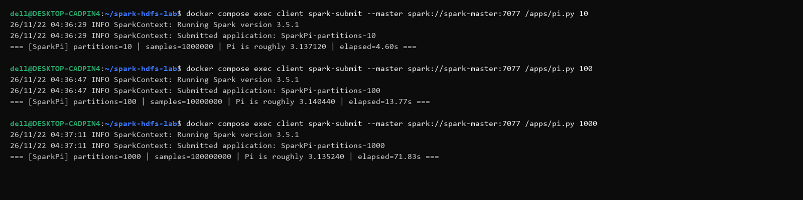

| Số Partition | Tổng số mẫu | Giá trị Pi ước lượng | Thời gian chạy | Nhận xét |
| :---: | :---: | :---: | :---: | :--- |
| **10** | 1,000,000 | `3.137120` | **4.60 s** | Chi phí quản lý task thấp, hoàn thành rất nhanh |
| **100** | 10,000,000 | `3.140440` | **13.77 s** | Cân bằng tốt nhất giữa độ chính xác và độ song song (4 cores) |
| **1000** | 100,000,000 | `3.135240` | **71.83 s** | Phát sinh quá nhiều task nhỏ làm tăng chi phí lập lịch |

### 5.2. Ví dụ 2 & BT3.2: Bài toán WordCount trên MovieLens và xem DAG
1. **Chạy `/apps/wordcount.py` đọc `movies.csv` từ HDFS và ghi kết quả về `/bigdata/output/wordcount`:**
   ```bash
   docker compose exec client spark-submit --master spark://spark-master:7077 /apps/wordcount.py
   docker compose exec client hdfs dfs -ls -h /bigdata/output/wordcount
   docker compose exec client hdfs dfs -cat /bigdata/output/wordcount/part-00000 | head -n 10
   ```
   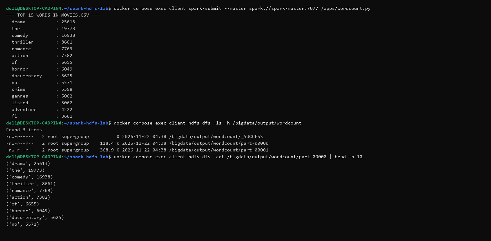

2. **Quan sát đồ thị DAG tại `http://localhost:4040` khi job đang chạy:**
   *(Truyền tham số thời gian giữ cổng `4040` mở, ví dụ `60` giây: `spark-submit --master spark://spark-master:7077 /apps/wordcount.py 60`)*.
   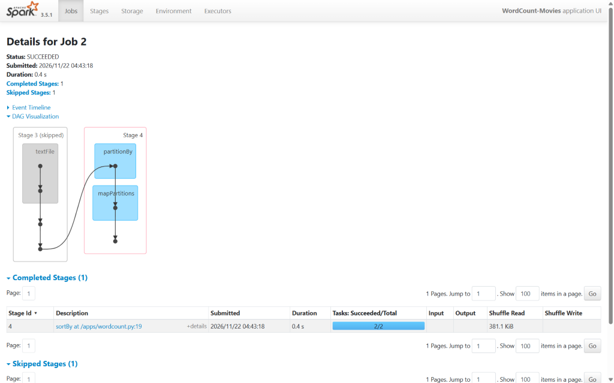

### 5.3. Bài tập BT3.3: Phân tích Top 10 bộ phim và xuất định dạng Parquet
Chạy `/apps/top10_movies.py` (tính điểm trung bình các phim có tối thiểu 50 lượt đánh giá, join với `movies.csv` và xuất định dạng Parquet) trên cả 2 tập dữ liệu `ratings_1m.csv` (25 MB) và `ratings_25m.csv` (647 MB):
```bash
# Chạy trên tập ratings_1m.csv (25 MB)
docker compose exec client spark-submit --master spark://spark-master:7077 --executor-memory 512m \
  /apps/top10_movies.py hdfs://namenode:9000/bigdata/input/ratings_1m.csv \
  hdfs://namenode:9000/bigdata/output/top10_movies_1m.parquet

docker compose exec client hdfs dfs -ls -h /bigdata/output/top10_movies_1m.parquet

# Chạy trên tập ratings_25m.csv (647 MB)
docker compose exec client spark-submit --master spark://spark-master:7077 --executor-memory 512m \
  /apps/top10_movies.py hdfs://namenode:9000/bigdata/input/ratings_25m.csv \
  hdfs://namenode:9000/bigdata/output/top10_movies_25m.parquet
```
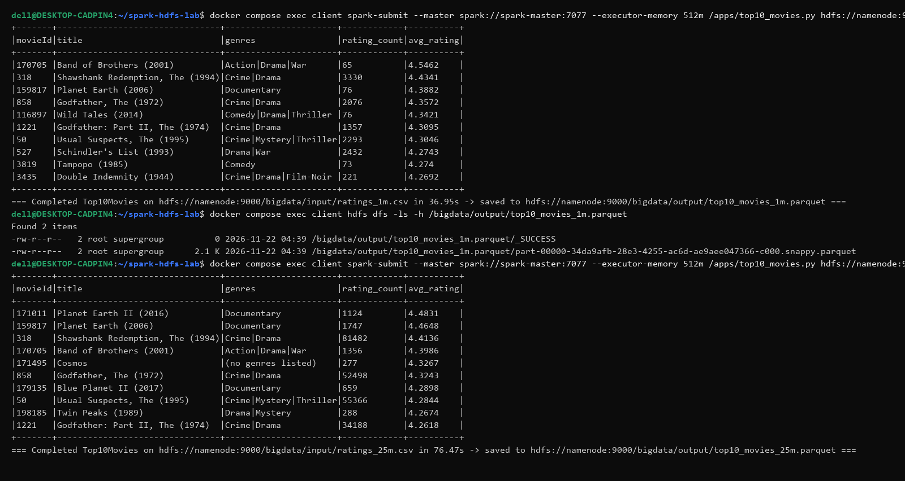

### 5.4. Bài tập BT3.4 & BT3.7: Giới hạn Cluster Mode và Spark History Server
- **Kiểm chứng Cluster Mode trên Standalone (BT3.4):**
  ```bash
  docker compose exec client spark-submit --master spark://spark-master:7077 --deploy-mode cluster /apps/pi.py 10
  ```
  Hệ thống báo ngoại lệ `SparkException: Cluster deploy mode is currently not supported for python applications on standalone clusters` (vì Standalone chỉ hỗ trợ cluster mode cho ứng dụng JVM `.jar`).
  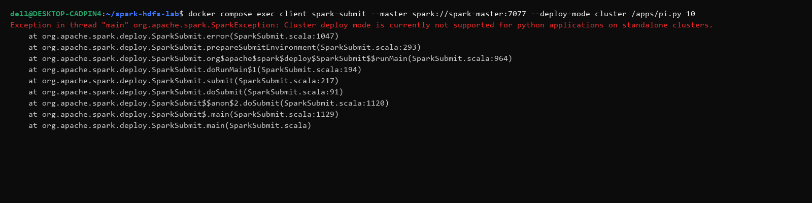

- **Giám sát lịch sử ứng dụng (BT3.7):**
  Mở `http://localhost:18080` để xem lại toàn bộ các ứng dụng đã chạy xong từ `hdfs://namenode:9000/spark-logs`.
  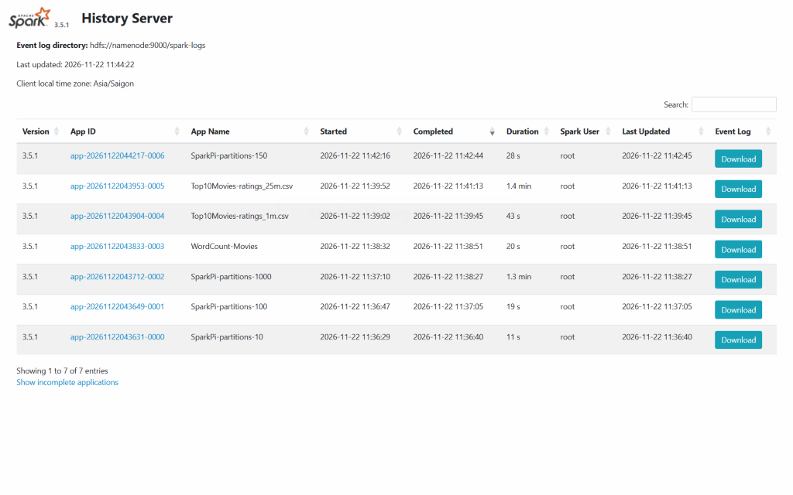

---

## 6. CHƯƠNG 4: Thực thi ứng dụng Spark trên YARN

### Bước chuẩn bị môi trường Buổi 4
Tắt nhóm Standalone, bật nhóm YARN cùng History Server, và tải bộ thư viện `/opt/spark/jars/*.jar` lên HDFS `/spark-jars` (chỉ cần đẩy 1 lần đầu để các lần submit sau không phải tải lại ~322 MB jar):
```bash
docker compose stop spark-master spark-worker1 spark-worker2
docker compose --profile yarn --profile history up -d
docker compose exec client hdfs dfsadmin -safemode wait

# Tải bộ jar của Spark lên HDFS /spark-jars một lần duy nhất
docker compose exec client hdfs dfs -mkdir -p /spark-jars
docker compose exec client bash -c "hdfs dfs -put -f /opt/spark/jars/*.jar /spark-jars/"
```

### 6.1. Bài tập BT4.1: Thực thi ứng dụng ở chế độ YARN Client Mode
Gửi ứng dụng `wordcount.py` lên YARN với `--deploy-mode client`:
```bash
docker compose exec client spark-submit --master yarn --deploy-mode client \
  --executor-memory 512m --num-executors 2 /apps/wordcount.py
```
- Tiến trình Driver chạy trên container `client`, kết quả Top 15 từ in trực tiếp ra màn hình terminal.
- Kiểm tra trên giao diện YARN ResourceManager (`http://localhost:8088`), ứng dụng hoàn tất với trạng thái `FINISHED / SUCCEEDED`.
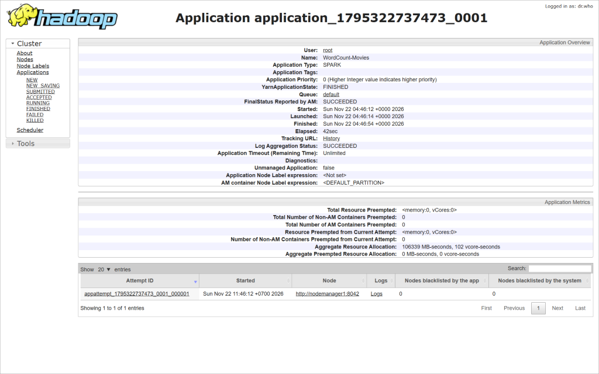

### 6.2. Bài tập BT4.2: Thực thi ứng dụng ở chế độ YARN Cluster Mode
1. **Gửi ứng dụng `top10_movies.py` ở chế độ `--deploy-mode cluster` (Driver chạy bên trong ApplicationMaster trên NodeManager):**
   ```bash
   docker compose exec client spark-submit --master yarn --deploy-mode cluster \
     --driver-memory 512m --executor-memory 512m --num-executors 2 \
     /apps/top10_movies.py hdfs://namenode:9000/bigdata/input/ratings_1m.csv \
     hdfs://namenode:9000/bigdata/output/top10_yarn_cluster.parquet
   ```
   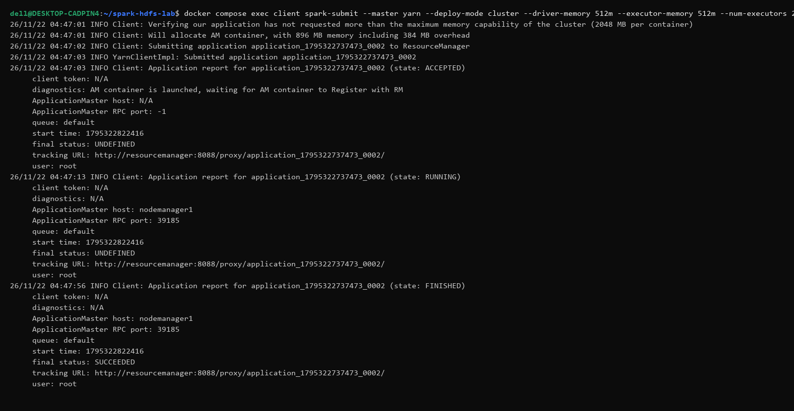

2. **Truy xuất kết quả từ luồng `stdout` của ApplicationMaster bằng lệnh `yarn logs`:**
   *(Thay `application_1795322737473_0002` bằng mã `application_id` thực tế hiển thị khi submit)*:
   ```bash
   docker compose exec client yarn logs -applicationId application_1795322737473_0002 | grep -A 16 "movieId"
   ```
   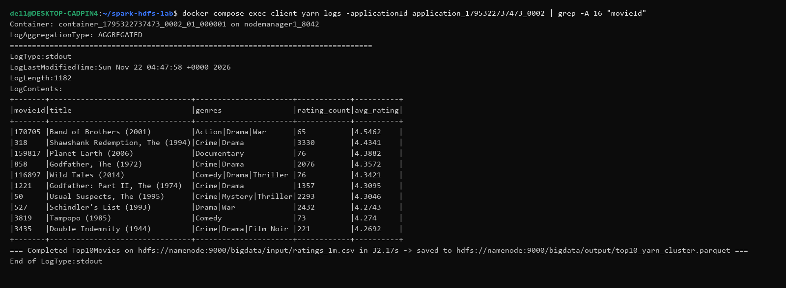

### 6.3. Bài tập BT4.6: So sánh Client vs Cluster Mode và Standalone vs YARN
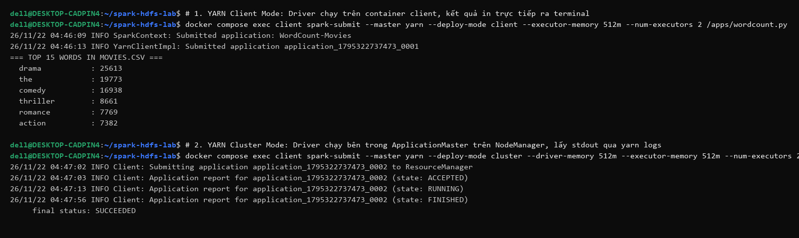

#### Bảng 1: So sánh Client Mode và Cluster Mode
| Tiêu chí | Client Mode (`--deploy-mode client`) | Cluster Mode (`--deploy-mode cluster`) |
| :--- | :--- | :--- |
| **Vị trí chạy Driver** | Trực tiếp trên máy gửi lệnh (`client`) | Bên trong container ApplicationMaster trên NodeManager |
| **Hỗ trợ PySpark** | Hỗ trợ trên cả Standalone và YARN | Không hỗ trợ trên Standalone; hỗ trợ đầy đủ trên YARN |
| **Xem kết quả `stdout`** | In trực tiếp ra terminal | Xem qua lệnh `yarn logs -applicationId <id>` |
| **Phụ thuộc phiên Client** | Đóng terminal là ứng dụng bị hủy ngay | Client ngắt kết nối job vẫn tiếp tục chạy |
| **Ứng dụng phù hợp** | Phát triển, gỡ lỗi, chạy tương tác | Triển khai Production tự động, chạy định kỳ |

#### Bảng 2: So sánh Spark Standalone và Spark on YARN
| Tiêu chí | Spark Standalone | Spark on YARN |
| :--- | :--- | :--- |
| **Điều phối cụm** | Spark Master (`7077`/`8080`) & Spark Worker | YARN ResourceManager (`8088`) & NodeManager |
| **Cấp phát tài nguyên** | Tĩnh theo số Core và RAM từng Worker | Linh hoạt theo Container (tính cả Memory Overhead) |
| **Hàng đợi đa người dùng** | FIFO đơn giản, phải giới hạn core thủ công | Tích hợp Capacity/Fair Scheduler với hàng đợi `ACCEPTED` |
| **Thu thập Log** | Xem từng Worker UI + History Server | Tự động gom log tập trung về HDFS + History Server |
| **Tốc độ khởi tạo** | Rất nhanh (~1–2 giây) | Đạt ~2–3 giây sau khi tối ưu `/spark-jars` trên HDFS |

---

## 7. Dừng cụm và Xử lý sự cố thường gặp

### 7.1. Dừng cụm an toàn (Giữ nguyên dữ liệu HDFS)
```bash
docker compose --profile standalone --profile yarn --profile history down
```
> **Lưu ý:** Tuyệt đối **không** dùng cờ `-v` (`docker compose down -v`) nếu bạn muốn giữ lại dữ liệu đã lưu trên HDFS cho các buổi làm việc tiếp theo.

### 7.2. Các lỗi thường gặp và cách xử lý nhanh
1. **Lỗi `Cannot create directory /spark-logs. Name node is in safe mode`:**
   - *Nguyên nhân:* NameNode vừa khởi động đang kiểm tra báo cáo block từ 2 DataNode trong ~10 giây đầu.
   - *Cách xử lý:* Chạy `docker compose exec client hdfs dfsadmin -safemode wait` rồi mới tạo thư mục hoặc submit job.
2. **Lỗi `File /spark-logs does not exist` khi chạy `spark-submit`:**
   - *Cách xử lý:* Tạo thư mục log sự kiện trên HDFS trước khi chạy Spark:
     `docker compose exec client hdfs dfs -mkdir -p /spark-logs`
3. **Lỗi `Required executor memory ... is above the max threshold (2048 MB)` trên YARN:**
   - *Nguyên nhân:* Mỗi NodeManager được cấu hình tối đa `2048 MB RAM`.
   - *Cách xử lý:* Đặt `--executor-memory 512m` (hoặc tối đa `1536m`).
